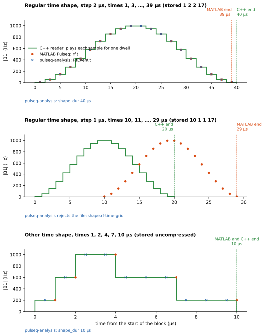
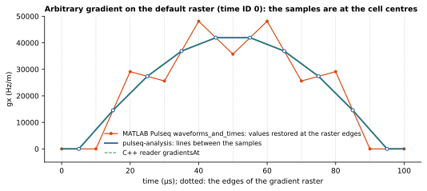

# Where the readers of a Pulseq file disagree, and what `spec` does

This document records each place where the sources that define how a Pulseq
file is read disagree, or where they leave a question open. For each one it
gives what each source does, an example, and what the interpreter `spec` of
pulseq-analysis does and why. It records the package as it is on 2026-10-13.
The sources and the runs on them are those of 2026-10-09, unless an entry says
otherwise.

The other interpreter, `cpp-siemens`, has its own record:
[`packages/pulseq-cpp-siemens/docs/specification.md`](../packages/pulseq-cpp-siemens/docs/specification.md),
in the plugin pulseq-cpp-siemens. Its rule is to do what the C++ reader does,
which the C++ row of each source table here gives; that record gives the rule
and each exception to it. Both records use the same IDs, one for each condition
in a file, and each has the entries that concern it: D59 and D60 are only in
the record of `cpp-siemens`, and D57 and D58 are reserved for task R16 of the
plan.

Until 2026-10-13 this document also had a section 4, a review of the package's
former strict reader against an order of preference of the sources (the C++
reader, the specification, MATLAB Pulseq, pypulseq). The two interpreters
replaced that goal (section 1 of the plan), so the section was removed; commit
`49a7e2c` is the last that has it.

Contents:

1. [The sources](#1-the-sources)
2. [Summary](#2-summary)
3. [The entries](#3-the-entries)
4. [Appendix: the acceptance matrix and the figures](#appendix-the-acceptance-matrix-and-the-figures)

## 1. The sources

Four sources define how a file is read. Each is fixed at one version.

| Source | Version | Where it is used | Cited as |
|---|---|---|---|
| The specification | `doc/specification.tex` of [pulseq/pulseq](https://github.com/pulseq/pulseq) at commit `c7469123c2f381f065986e6cc3a7d09730ed16ef`: "Version 1.5.3 (DRAFT)". The PDF of that commit (`doc/specification.pdf`) is made from it. | The definition of the format. | `spec:N`, line N of `specification.tex`, with the section number of the PDF |
| The C++ reader | `src/ExternalSequence.cpp` and `src/ExternalSequence.h` of pulseq/pulseq at the same commit, built by `flake.nix` as `pulseq-cpp-oracle` with the driver of `tests/cpp_oracle/` | The reader of the Pulseq interpreter on the scanner: what the scanner plays. | `cpp:N` (`.cpp`), `cpp.h:N` (`.h`) |
| MATLAB Pulseq | `matlab/` of pulseq/pulseq at the same commit, run under GNU Octave 11.3.0 by `pulseq-matlab-oracle` (`tests/matlab_oracle/`) | The toolbox that writes most Pulseq files. | `read.m:N`, `Sequence.m:N` (`matlab/+mr/@Sequence/`), `restoreAdditionalShapeSamples.m:N` (`matlab/+mr/`) |
| pypulseq | The pin of `pyproject.toml`: the fork [mdtisdall/pypulseq](https://github.com/mdtisdall/pypulseq) at `3c3bd8515e591ef859399aa20db64b1bd2c3a725` (pypulseq 1.5.0.post1 and six commits) | The reader behind `load(path)`, which does not use the interpreters yet (task R14). | `read_seq.py:N`, `sequence.py:N` (`pypulseq/Sequence/`), `event_lib.py:N` (`pypulseq/`) |

pulseq-analysis ("the package") reads a file with `read_seqfile(path,
interpreter)` (`docs/usage.md`, "The interpreters"). Its built-in interpreter,
`spec` (the default: `read_seqfile(path)`), reads a file as the Pulseq
specification describes it, and for timing as the slide set that its section
2.6 cites (`doc/pulseq_shapes_and_times.pdf` of the same commit, cited as
"slide N"; normative for timing, the user, 2026-10-12). It rejects a file where
they say "must", with every violation and a code for each (`spec.RULES`).
Where they are silent it reads the file as section 6 of the plan chose, and
rejects a file only where no current writer (MATLAB Pulseq, pypulseq) writes
such a file; the message of such a rejection says that it is the package's
choice and why. It replaced the strict reader that the package had before the
interpreters (task R11).

A version outside 1.4.0 to 1.5.x raises `NotSupported` (decision Q1), and says
nothing about the file. The package reports no discrepancy itself:
pulseq-checks does (P17). The decisions P1 to P21 and Q1 to Q6 that this
document cites are those of sections 2 and 3 of
`docs/plans/parser-redesign.md` ("the plan"). The entries of section 3 give
what `spec` does and why.

Each statement about a source was checked in one of three ways:

- by reading its code at the commit above (the citation gives the file and the
  line);
- by a run on 2026-10-09, on an Apple M1 Max (macOS 26.6.2, arm64): the
  acceptance matrix (`scripts/discrepancy_matrix.py`, appendix; run again on
  2026-10-13 with the fixtures of R11, and the same verdicts of the other
  readers for the earlier fixtures), or a small file that the entry shows (run
  through the same four readers as the matrix). The C++ reader is the macOS
  build of `pulseq-cpp-oracle`. "Crash" is a signal (exit status 70 of the
  driver). Where the reader reads memory that it does not own, the result can
  depend on the build; or
- by a run on 2026-10-12 of `spec` (before task R11, of the strict reader) on
  the fixture or the small file that the entry names, with `pulseq-cpp-oracle`
  on the same file.

The matrix gives two columns for pypulseq. Most fixtures have a `ROTATIONS`
extension, and pypulseq's `read` rejects every file with one, so the column
"pypulseq, probe" reads a copy of each file without the extensions that
pypulseq does not read, without `RequiredExtensions`, and with time ID -1 set
to 0. An entry says "probe" when it cites that column.

## 2. Summary

The verdicts are short. "Accepts" and "reads" mean that the source goes on with
no error; "rejects" means an error; "silent" means that the source has no rule.
The last column is the interpreter `spec`: "not supported" is the
`NotSupported` exception; "(choice)" marks a rejection of `spec` that the
specification does not state, which its message says.

| ID | Condition in the file | Specification | C++ reader | MATLAB Pulseq | pypulseq | `spec` |
|---|---|---|---|---|---|---|
| [D01a](#d01a-an-rf-row-with-12-fields) | `[RF]` row with 12 fields | prose: 7 numbers, line: 8 fields; table and example: 12 | 12 | 12 | 12 | 12 |
| [D01b](#d01b-a-gradients-row-with-7-fields) | `[GRADIENTS]` row with 7 fields | prose: 4 numbers; line, table and example: 7 | 7 | 7 | 7 | 7 |
| [D01c](#d01c-an-adc-row-with-9-fields) | `[ADC]` row with 9 fields | prose: 6 numbers; line, table and example: 9 | 9 | 9 | 9 | 9 |
| [D02](#d02-a-file-with-no-version-section) | No `[VERSION]` | recommends to reject | rejects | rejects | fails (`UnboundLocalError`) | rejects |
| [D03](#d03-a-file-whose-version-is-before-140-or-after-15x) | Version outside 1.4.0 to 1.5.x | silent | 1.2.0 and later | 1.2.0 and later, major 1 | 1.2.0 and later | not supported |
| [D04](#d04-a-version-line-whose-value-is-not-a-plain-integer-such-as-minor-50) | `[VERSION]` value such as `5.0` | `major <major>` | reads `5.0` as 5 | reads `5.0` | rejects `5.0`; cuts `revision` | rejects |
| [D05](#d05-sections-in-an-unusual-order-such-as-version-after-blocks-or-last-in-the-file) | `[VERSION]` after `[BLOCKS]` or last | silent | any order; crash with `[VERSION]` last | `[VERSION]` before `[BLOCKS]` | `[VERSION]` before `[BLOCKS]` | any order |
| [D06](#d06-a-blank-or--line-inside-a-section-with-data-after-it) | Blank or `#` line inside a section | silent | blank line; `#` is data | blank or `#` line | blank line or a lone `#` | skips blank and `#` lines |
| [D07](#d07-a-shape-whose-last-sample-is-followed-by-the-next-shape_id-with-no-blank-line) | No blank line after a shape | blank line | `shape_id` line too; drops the rest | blank or `#` line | blank or a lone `#` | rejects (choice) |
| [D08](#d08-a-section-that-the-format-does-not-have) | Unknown section | silent | ignores | rejects | rejects | ignores |
| [D09](#d09-a-delays-section-in-a-file-of-140-or-later) | `[DELAYS]` from 1.4.0 | removed in 1.4.0 | ignores | rejects | rejects | ignores |
| [D10](#d10-a-section-that-appears-twice) | A section twice | silent | reads the last | adds or last, by section | adds or last, by section | rejects (choice) |
| [D56](#d56-the-last-section-with-no-blank-line-after-it) | Last section with no blank line after it | silent | skips the sections it reads after it | reads | fails (`AttributeError`) | reads |
| [D11](#d11-a-required-raster-that-is-missing-zero-negative-or-not-finite) | Missing or invalid raster | required | presence; value partly | presence | defaults | rejects missing, invalid; commensurate (slide 11) |
| [D12](#d12-a-definition-that-appears-twice) | A definition twice | silent | last wins | last wins | last wins | last wins |
| [D13](#d13-a-definition-or-a-signature-hash-whose-text-reads-as-a-number) | Definition or hash that reads as a number | `any`, hash `string` | text and numbers | numbers when they parse; hash too | numbers; hash text | text |
| [D14](#d14-a-number-with-a-fraction-in-an-integer-column-a-sign-or-nan-a-row-with-too-few-or-too-many-columns-bytes-that-are-not-utf-8) | Number syntax, columns, encoding | types only | partly | lenient | partly | types; rejects `nan`, negatives, non-UTF-8 (choice) |
| [D15](#d15-an-adc-dwell-time-written-with-a-decimal-point-such-as-25000) | ADC dwell `2500.0` | float | rejects | reads | reads | reads |
| [D16](#d16-a-soft-delay-row-with-a-fractional-offset-such-as--1005-or-a-hint-longer-than-31-characters) | Soft delay offset `-100.5`; long hint | integer in the example | misreads `-100.5`; cuts the hint | reads | rejects `-100.5` | reads (float) |
| [D17](#d17-an-rf-use-letter-that-is-not-one-of-e-r-i-s-p-o-u) | RF `use` letter not in the list | one of 7 letters | any character | any | any | rejects |
| [D18](#d18-a-value-with-more-digits-than-a-32-bit-float-holds) | Value beyond 32-bit precision | shapes float32 | float32 | double | float64 | float64 |
| [D19](#d19-ids-that-are-not-positive-or-not-unique) | IDs not positive or not unique | must | silent (last wins) | mixed | silent | rejects (blocks: choice) |
| [D20](#d20-block-ids-that-are-not-in-increasing-order) | Block IDs out of order | no restriction | file order | ID order | file order | file order |
| [D21](#d21-a-reference-to-an-event-shape-or-extension-that-does-not-exist) | Reference that does not resolve | implied | partly; crashes | mostly rejects | partly | rejects |
| [D22](#d22-time-id--1-for-an-rf-event-or-in-a-14-file) | Time ID -1 for RF, in 1.4 | gradients only | crashes (RF) | default raster (RF) | fails (`KeyError`) | rejects |
| [D23](#d23-a-cycle-in-an-extension-list) | Cycle in an extension list | implied | no end | no end (code) | reads | rejects |
| [D24](#d24-a-file-with-no-block) | No block | must | accepts | reads | reads | rejects |
| [D25](#d25-an-event-that-lasts-longer-than-its-block) | Event longer than its block | interpreter must reject | accepts | reads | reads | rejects |
| [D26](#d26-a-time-that-is-not-a-multiple-of-its-raster) | Times off a raster | must | accepts | reads | reads | rejects; RF and ADC start on the RF raster (slides 9, 10) |
| [D27](#d27-a-gradient-that-starts-above-0-after-a-delay-or-ends-above-0-before-the-end-of-its-block) | Gradient non-zero at an end | must / need to | accepts | reads | reads | rejects |
| [D28](#d28-an-arbitrary-gradient-on-a-gradient-raster-other-than-10-µs) | Arbitrary gradient off 10 µs | allowed | rejects | reads | reads | reads (commensurate raster) |
| [D29](#d29-a-shape-that-does-not-have-the-number-of-samples-that-it-declares) | Shape length | must | accepts | reads | reads | rejects |
| [D30](#d30-an-amplitude-shape-with-a-sample-outside--1-1) | Shape outside [-1, 1] | must | clamps | reads | reads | rejects |
| [D31](#d31-an-rf-magnitude-shape-with-a-sample-below-0) | RF magnitude below 0 | allowed | clamps to 0 | reads | reads | plays as written |
| [D32](#d32-an-rf-phase-shape-with-a-sample-outside-0-1) | RF phase outside [0, 1) | silent | clamps | reads | reads | plays as written |
| [D33](#d33-a-shape-with-no-sample-that-an-event-uses) | Empty shape | silent | crashes | rejects | rejects | rejects (choice) |
| [D34](#d34-the-shapes-of-one-event-with-different-numbers-of-samples) | Shapes of one event, two lengths | silent | crashes | rejects | reads | rejects (choice) |
| [D35](#d35-an-rf-time-shape-stored-compressed-in-3-or-4-values-a-regular-step) | Regular RF time shape (3 or 4 stored values) | times in the shape | dwell from the shape; first time ignored | times of the shape | times of the shape | cells when `(i + 0.5) d`, else points |
| [D36](#d36-an-rf-time-shape-stored-in-any-other-form) | Other RF time shape | times in the shape | resamples; can read past the end | times of the shape | times of the shape | points, complex lines; any time |
| [D37](#d37-an-rf-time-shape-whose-last-time-is-before-the-end-of-the-last-samples-dwell) | RF time shape that ends inside its last dwell | silent | dwell × samples | last time rounded up | last time rounded up | `N d`, or the last point |
| [D38](#d38-an-rf-event-of-a-14-file-which-has-no-center-column) | 1.4 RF event, no `center` | not in 1.4 | -1 (invalid) | computed | computed | absent |
| [D39](#d39-a-14-arbitrary-gradient-on-the-default-raster-which-has-no-first-and-last-columns) | 1.4 gradient on the default raster | not in 1.4 | about 0 | alternating sum | extrapolation | rejects (choice) |
| [D40](#d40-a-14-arbitrary-gradient-with-a-time-shape-which-has-no-first-column) | 1.4 time-shaped gradient, no `first` | not in 1.4 | first sample | from the block before | from the block before | first sample |
| [D41](#d41-an-arbitrary-gradient-on-the-default-raster-time-id-0-whose-samples-are-at-the-centres-of-the-raster-cells) | Time-ID-0 gradient between its samples | centres of cells | lines | restores the edges | lines | lines |
| [D42](#d42-a-gap-between-two-gradient-events-on-one-axis) | Gap between gradient events | silent | one block only | ramps to 0 | straight line | 0 in a block; across blocks R14 |
| [D43](#d43-an-oversampled-arbitrary-gradient-time-id--1) | Oversampled gradient | defined | keeps the centres | reads | fails (`KeyError`) | all the samples; rejects an even count |
| [D44](#d44-an-adc-event-with-a-phase-modulation-shape) | ADC phase modulation shape | none | rad | as stored | not checked | rad, one per sample |
| [D45](#d45-an-unknown-extension-that-the-file-does-not-require) | Unknown extension, not required | may ignore | ignores | ignores | rejects | ignores; records it |
| [D46](#d46-a-file-whose-last-section-that-starts-with--is-extensions) | `[EXTENSIONS]` last | silent | rejects | reads | reads | accepts |
| [D47](#d47-an-unknown-extension-that-the-file-requires) | Unknown required extension | must reject | rejects | reads | reads | rejects |
| [D48](#d48-a-block-with-more-than-one-rotations-or-rf_shims-object) | Two ROTATIONS or RF_SHIMS in a block | one only | warns, uses the first | rejects | rejects any ROTATIONS | rejects |
| [D49](#d49-a-block-that-plays-a-rotation-or-a-quaternion-that-is-not-normalized) | Played rotation; quaternion norm | normalized quaternion | normalizes; rejects off by 1e-3; does not rotate | normalizes, rotates | rejects | normalizes and rotates from 1.5.1; rejects norm 0 (choice) |
| [D50](#d50-a-labelset-or-labelinc-row-with-a-label-name-that-a-reader-does-not-know) | Unknown label name | lists labels | ignores the label | rejects | rejects | reads; records it |
| [D51](#d51-two-event-rows-with-equal-values-and-different-ids-such-as-amplitudes-0-and--0) | Equal events, different IDs | silent | keeps | keeps | merges, renumbers | keeps |
| [D52](#d52-any-file-it-holds-no-dead-time-ringdown-time-or-default-raster-of-a-scanner) | No values of a target in the file | not in the file | none | dead times | dead times, default rasters | none |
| [D53](#d53-a-signature-hash-in-a-file-with-crlf-line-ends-or-a-hash-that-does-not-match-the-file) | Signature: CRLF line ends, mismatch | strip the `\n` | drops the empty line | no check | no check | the specification's rule |
| [D54](#d54-a-signature-section-without-type-or-hash) | `[SIGNATURE]` without `Type` or `Hash` | must have both | accepts | reads | reads | rejects |
| [D55](#d55-an-extension-header-whose-string_id-is-a-word-where-the-specifications-table-gives-the-type-integer) | `STRING_ID` that is a word | integer in the table; a word in the examples | text | text | text | text |

## 3. The entries

### Format and structure

#### D01a: An `[RF]` row with 12 fields

| Source | What it does |
|---|---|
| Specification | Section 2.8.1 describes the row three ways. The prose says "a single line containing seven numbers", and the line under it has 8 fields: `<id> <amp> <mag_id> <phase_id> <time_id> <delay> <freq> <phase>` (`spec:334-336`). The table has 12 fields: `<center>` before `<delay>`, and `<freq_ppm>`, `<phase_ppm>` and `<use>` (`spec:341-359`). The example has 12 (`spec:366-369`). |
| C++ reader | Reads 12 values in a 1.5 file (`cpp:1042-1048`). |
| MATLAB Pulseq | Reads 12 values (`read.m:120`). |
| pypulseq | Reads 12 values (`read_seq.py:151`). |

Example: the first row of the example of section 2.8.1,
`1 550 1 2 0 1000 100 0.000 0.0000 0.000 0.000 e`. By the line of the prose,
the delay is 1000 µs and the frequency offset is 100 Hz. By the table, the
center is at 1000 µs and the delay is 100 µs, as the text under the example
says (`spec:372`).

Package (`spec`): reads the 12 fields of the table, in its order (the columns of
`as_written`). A row with another number of fields is `syntax.columns`. A 1.4.x
file has its own layout of 8 fields (D38).

Reason: where the prose of the specification contradicts its tables and
examples, `spec` follows the tables and examples, as the C++ reader and MATLAB's
files do: they agree with each other.

Note: the specification has another slip of the text that does not change how a
file is read: the paragraph of the soft delay extension starts "Label extension
can be used" (`spec:545`).

#### D01b: A `[GRADIENTS]` row with 7 fields

| Source | What it does |
|---|---|
| Specification | Section 2.8.2 says that each arbitrary gradient is "specified by four numbers", and the line under it has 7 fields: `<id> <amp> <first> <last> <shape_id> <time_id> <delay>` (`spec:375-377`). The table and the example have 7 (`spec:386-413`). Only the count of the prose differs; the line, the table and the example agree. |
| C++ reader | Reads 7 values in a 1.5 file (`cpp:1073`). |
| MATLAB Pulseq | Reads 7 values (`read.m:130`). |
| pypulseq | Reads 7 values (`read_seq.py:165`). |

Example: the example row of section 2.8.2, `1 790127 0 -550073 6 0 980`.

Package (`spec`): reads the 7 fields of the table. A row with another number of
fields is `syntax.columns`. A 1.4.x file has its own layout of 5 fields (D39,
D40).

Reason: as in D01a.

#### D01c: An `[ADC]` row with 9 fields

| Source | What it does |
|---|---|
| Specification | Section 2.8.3 says that each ADC event is "specified by six numbers", and the line under it has 9 fields: `<id> <num> <dwell> <delay> <freq_ppm> <phase_ppm> <freq> <phase> <phase_shape_id>` (`spec:424-426`). The table and the example have 9 (`spec:431-453`). Only the count of the prose differs; the line, the table and the example agree. |
| C++ reader | Reads 9 values in a 1.5 file (`cpp:1148-1149`). |
| MATLAB Pulseq | Reads 9 values (`read.m:140`). |
| pypulseq | Reads 9 values (`read_seq.py:176`). |

Example: the example rows of section 2.8.3.

Package (`spec`): reads the 9 fields of the table. A row with another number of
fields is `syntax.columns`. A 1.4.x file has its own layout of 6 fields.

Reason: as in D01a.

#### D02: A file with no `[VERSION]` section

| Source | What it does |
|---|---|
| Specification | "the interpreter sequence may either refuse execution or assume version 1.0.0. It is recommended to reject Pulseq files without [VERSION] section." (section 2.3, `spec:201`) |
| C++ reader | Rejects: "supported Pulseq files MUST contain the [VERSION] section" (`cpp:912-916`). |
| MATLAB Pulseq | Rejects at `[BLOCKS]`: "Pulseq file MUST include [VERSION] section prior to [BLOCKS] section" (`read.m:114-116`). |
| pypulseq | Fails with `UnboundLocalError` at `[BLOCKS]` (`read_seq.py:139`): its variable of the version is not set. |

Example: `tests/seqfiles/bad_version_missing.seq` (matrix: C++ rejects,
MATLAB rejects, pypulseq `UnboundLocalError`).

Package (`spec`): `version.missing`.

Reason: the specification recommends to reject a file without `[VERSION]`
(spec:201), and `spec` needs the version to know the layout of the tables.

#### D03: A file whose version is before 1.4.0 or after 1.5.x

| Source | What it does |
|---|---|
| Specification | Gives the format of 1.5.3. It has no rule for a reader and a version that the reader does not know. |
| C++ reader | Rejects a version before 1.2.0 (`cpp:918-922`) and ports 1.2 and 1.3 files (`cpp:1656-1711`). It has no upper bound: it accepts 1.6.0 (matrix, `bad_version_unsupported_1_6.seq`). |
| MATLAB Pulseq | Asserts major 1 (`read.m:98`), rejects before 1.2.0 (`read.m:103-105`), and ports older files (`read.m:216-321`). It reads 1.6.0 (matrix). |
| pypulseq | Rejects before 1.2.0 (`read_seq.py:118-122`). A version above its own gives a warning (`read_seq.py:111-116`). It reads 1.6.0 (probe). |

Example: `tests/seqfiles/bad_version_unsupported_1_6.seq` (a 1.5.1 file with
`minor 6`) and `bad_version_unsupported_1_3.seq` (`minor 3`). The 1.3 fixture
keeps the 1.5 tables, so the other readers fail on its tables, not on its
version (matrix: C++ rejects, MATLAB "nonconformant arguments", pypulseq
"Mismatch between number of tokens and format spec").

Package (`spec`): raises `NotSupported` for a version before 1.4.0 or from
1.6.0. Both fixtures of the example raise it.

Reason: the package reads the versions 1.4.0 to 1.5.x (decision Q1). It refuses
another version as not supported by the package, with an exception that says
nothing about the file, so that a new version fails loudly, not wrongly.

#### D04: A `[VERSION]` line whose value is not a plain integer, such as `minor 5.0`

| Source | What it does |
|---|---|
| Specification | Three lines `major <major>`, `minor <minor>`, `revision <revision>` (section 2.3, `spec:193-198`). |
| C++ reader | Reads each number with `sscanf("%d")` (`cpp:882-901`), so `minor 5.0` is 5. An unknown key makes it reject (`cpp:902-906`). |
| MATLAB Pulseq | Reads each number with `str2double` (`read.m:479-491`): `5.0` is 5. An unknown key is skipped. |
| pypulseq | Reads each number with `int()` (`read_seq.py:504-512`): `5.0` raises `ValueError`. It keeps only the first character of a revision of more than one character (`read_seq.py:510-511`): `revision 10` is read as 1. |

Example: `tests/seqfiles/bad_version_invalid.seq` has `minor 5.0` (matrix: C++
accepts, MATLAB reads, pypulseq `ValueError`).

Package (`spec`): `version.invalid`: each line is one of the three keys with one
integer (`minor 5.0` is not one), and each key appears once; a second
`[VERSION]` section is `section.duplicate` (D10).

Reason: section 2.3 of the specification gives each value as an integer
(spec:193-198), and `spec` reads it as one.

#### D05: Sections in an unusual order, such as `[VERSION]` after `[BLOCKS]` or last in the file

| Source | What it does |
|---|---|
| Specification | Silent, except that the file "may end with" `[SIGNATURE]` (section 2.4, `spec:213`). |
| C++ reader | Finds each section by an index of the file (`cpp:870`, `cpp:1750-1801`), so the order does not matter. |
| MATLAB Pulseq | Reads the sections in file order, and rejects `[BLOCKS]` before `[VERSION]` (`read.m:114-116`). |
| pypulseq | Reads in file order; `[BLOCKS]` before `[VERSION]` fails with `UnboundLocalError` (`read_seq.py:139`). |

Example: a run of `valid_1_5_1.seq` with its sections in the order
`[DEFINITIONS]`, `[BLOCKS]`, `[VERSION]`, `[RF]`, `[GRADIENTS]`, `[TRAP]`,
`[ADC]`, `[EXTENSIONS]` with its extension sections, and `[SHAPES]`, and with no
`[SIGNATURE]`: `spec` and the C++ reader accept it; MATLAB
rejects it ("MUST include [VERSION] section prior to [BLOCKS]"); pypulseq fails
with `UnboundLocalError`. The same file with `[VERSION]` as the last section
made the C++ reader crash in the run
(`tests/seqfiles/undefined/version_last.seq` is such a file).

Package (`spec`): reads the sections in any order (`undefined/version_last.seq`
is read).

Reason: the specification is silent on the order, and `spec` accepts any. The
C++ reader's failure with `[VERSION]` last comes from its stream, not from a
rule of the format (D56).

#### D06: A blank or `#` line inside a section, with data after it

| Source | What it does |
|---|---|
| Specification | "Comments are specified by a line starting with a hash" (section 2.1, `spec:171`). It does not say whether a blank line or a comment can be inside a section, except in `[SHAPES]` (D07). |
| C++ reader | Its line reader keeps white space (`cpp:2295-2342`). A table ends at an empty line or a `[` line (`cpp:1004`, `cpp:1064`, `cpp:1112`, `cpp:1141`, `cpp:1558`). A `#` line inside a table is read as a row, and its decoding fails: reject. `[VERSION]` and `[EXTENSIONS]` skip blank and `#` lines (`cpp:878`, `cpp:908`, `cpp:1219`). It never reads a line after the end of a table: only `[` lines start a section (`cpp:1762-1769`). |
| MATLAB Pulseq | A section ends at an empty line or a line whose first character is `#` (`read.m:503`, `read.m:564`, `read.m:606`, `read.m:633`). The next line that is not blank or `#` must be a section header, else "Unknown section code" (`read.m:50`, `read.m:192`). |
| pypulseq | A section ends at an empty line or a line that is exactly `#` (`read_seq.py:545`, `read_seq.py:606`, `read_seq.py:656`). A line `# comment` inside a table is read as a row and fails (probe, `bad_syntax_line_after_comment.seq`: `ValueError`). |

Example: `tests/seqfiles/bad_syntax_line_after_comment.seq` has a `#` line
after the first row of `[BLOCKS]`, and the other rows after it: the C++ reader
rejects it (it decodes the `#` line as a block), MATLAB rejects it ("Unknown
section code: 2  50  0  1 …"), pypulseq rejects it. `bad_syntax_line.seq` has
a row `1 2 3` before the first section: the C++ reader accepts it (the row is
never read), MATLAB and pypulseq reject it ("Unknown section code: 1 2 3").
`valid_comments_between_sections.seq` has comments between sections: all
accept (pypulseq: probe).

Package (`spec`): skips a blank or `#` line anywhere: between sections, inside a
table (`bad_syntax_line_after_comment.seq` is read, with all its blocks) and
inside a shape, where a `#` line is skipped and a blank line ends the shape
(D07; `valid_comment_in_shape.seq`). A data line before the first header is
`syntax.line` (`bad_syntax_line.seq`).

Reason: the specification makes a comment of any line that starts with a hash
(spec:171), and gives no rule that a blank line ends a table; the user chose to
skip both (section 6 of the plan). A data line before the first section is in no
section: the specification has no such line, MATLAB and pypulseq reject it, and
no current writer writes one, so `spec` rejects it, and its message says that
this is the package's choice.

#### D07: A shape whose last sample is followed by the next `shape_id` with no blank line

| Source | What it does |
|---|---|
| Specification | "The end of the shape definition is declared with a blank line." (section 2.9, `spec:602`) |
| C++ reader | The samples of a shape end at an empty line or a line that starts with `s` (`cpp:955-958`). After a shape it reads the next non-comment line (`cpp:978`), and it stops reading `[SHAPES]` when that line does not start with `s` (`cpp:939`). So after a `shape_id` line with no blank line before it, the reader reads the `num_samples` line as the next line and stops: the later shapes are not read. |
| MATLAB Pulseq | The samples end at an empty or `#` line (`read.m:653`). A `shape_id` line before that is read as a sample. |
| pypulseq | The samples end at an empty line or a lone `#` (`read_seq.py:699`). A `shape_id` line is read as a sample with `float()` (`read_seq.py:700`). |

Example: `tests/seqfiles/bad_syntax_shape_no_blank_line.seq` has `shape_id 5`
right after the last sample of shape 4. Matrix: the C++ reader crashes, MATLAB
rejects ("mr.decompressShape() failed for shapeId 4"), pypulseq rejects
("could not convert string to float: 'shape_id 5'", probe).
`bad_syntax_shape.seq` has a shape with no `num_samples` line: C++ rejects,
MATLAB rejects, pypulseq `IndexError` (probe).

Package (`spec`): `syntax.shape` for a shape with no blank line after it: a
`shape_id` line right after its samples (`bad_syntax_shape_no_blank_line.seq`;
the shape before it is still read), or a header or the end of the section right
after the last shape (`bad_syntax_shape_end.seq`); and for a shape without its
two header lines (`bad_syntax_shape.seq`), also when a blank line comes between
them. A `#` line inside a shape is skipped (D06).

Reason: `spec` follows section 2.9 of the specification: the end of a shape is
declared with a blank line (spec:602). The specification does not say what a
shape without one is, and no current writer writes one, so `spec` rejects it
(the user's choice; the message says so).

#### D08: A section that the format does not have

| Source | What it does |
|---|---|
| Specification | Lists the sections (sections 2.3 to 2.9). It has no rule for another. |
| C++ reader | Indexes every `[` line (`cpp:1762-1769`) and reads only the sections that it knows: it ignores another (matrix: accepts). |
| MATLAB Pulseq | "Unknown section code" (`read.m:192`). |
| pypulseq | `ValueError` "Unknown section code" (`read_seq.py:229-230`). |

Example: `tests/seqfiles/bad_section_unknown.seq` has `[FOO]`.

Package (`spec`): ignores the section (`bad_section_unknown.seq` is read).

Reason: the specification lists its sections and has no rule for another one;
the user chose to ignore it (section 6), as the C++ reader does. pulseq-checks
reports it.

#### D09: A `[DELAYS]` section in a file of 1.4.0 or later

| Source | What it does |
|---|---|
| Specification | The table of revisions gives, for 1.4.0, "removed [DELAYS]" (`spec:114`). The binary format lists `[DELAYS]` as "legacy, deprecated" and says "Current readers ignore this section for compatibility with old files" (`spec:743`, `spec:772`). |
| C++ reader | Reads it (`cpp:1172-1192`) and uses it only for a file before 1.4.0 (`cpp:1656-1711`): accepts. |
| MATLAB Pulseq | "Pulseq file revision 1.4.0 and above MUST NOT contain the [DELAYS] section" (`read.m:146-149`). |
| pypulseq | `RuntimeError`: "Pulseq file revision 1.4.0 and above MUST NOT contain [DELAYS] section" (`read_seq.py:184-186`). |

Example: `tests/seqfiles/bad_section_delays.seq`.

Package (`spec`): ignores `[DELAYS]` (`bad_section_delays.seq` is read).

Reason: the specification removed `[DELAYS]` in 1.4.0 (spec:114) and says that
current readers ignore it (spec:772); `spec` ignores it too.

#### D10: A section that appears twice

| Source | What it does |
|---|---|
| Specification | Silent. |
| C++ reader | Its index keeps the position of the last header with a name (`cpp:1768`), so it reads the last section of that name: accepts. |
| MATLAB Pulseq | Reads each copy in file order (matrix: reads). A second `[GRADIENTS]` or `[TRAP]` adds to the gradients already read (the library is passed on, `read.m:128-137`); a second copy of any other section replaces the first (`read.m:113-181`): its last copy. |
| pypulseq | Reads each copy (probe: reads). A second `[RF]`, `[GRADIENTS]`, `[TRAP]`, `[ADC]` or `extension TRIGGERS` adds to the first (`read_seq.py:147-196`); a second `[BLOCKS]`, `[SHAPES]`, `[DEFINITIONS]` or `[EXTENSIONS]` replaces it (`read_seq.py:73-191`). |

Example: `tests/seqfiles/bad_section_duplicate.seq` has a second `[TRAP]`
(MATLAB adds its rows to the first; the C++ reader reads the second only).

Package (`spec`): `section.duplicate` for a section that appears twice,
`[VERSION]` and `[SIGNATURE]` included (`bad_section_duplicate.seq`,
`bad_section_duplicate_signature.seq`), and for two `extension` sections with
one `STRING_ID` (`bad_section_duplicate_extension.seq`); only the first copy is
read.

Reason: the specification is silent, the three readers read a second copy in
three ways (above), and no current writer writes one, so `spec` rejects the file
(the user's choice, 2026-10-13, which replaced the reading of the copies as one;
the message says so).

#### D56: The last section with no blank line after it

| Source | What it does |
|---|---|
| Specification | Silent. It declares the end of a shape with a blank line (section 2.9, `spec:602`) and says nothing about a blank line after another section, or about the end of the file. |
| C++ reader | Reads a table with its `getline` up to an empty line or a `[` line. At the end of the file, `is.get()` sets the failbit of the stream (`cpp:2301`), and `getline` also seeks to -1 when it has read nothing (`cpp:2322-2326`). So a section that runs to the end of the file, with no blank line after its last row, leaves the stream failed, and the reader skips each section that it reads after it, in its own order: `[VERSION]` (`cpp:877`), `[SHAPES]` (`cpp:933`), `[RF]`, `[GRADIENTS]`, `[TRAP]`, `[ADC]`, `[DELAYS]`, `[EXTENSIONS]` (`cpp:999-1204`), `[DEFINITIONS]` (`cpp:1399`), `[BLOCKS]` (`cpp:1550`), `[SIGNATURE]` (`cpp:1602`). Only `[SHAPES]` resets the stream, after it has read the section (`cpp:980`). |
| MATLAB Pulseq | Reads a section up to an empty line or the end of the file with `fgetl`: reads the files of the example (run). |
| pypulseq | An event table at the end of the file fails with `AttributeError` (run): `__strip_line` returns -1 at the end of the file, and `__read_events` takes it for a line (`read_seq.py:604-607`, `read_seq.py:757-772`). `[DEFINITIONS]` as the last section is read (run). |

Example: a 1.5.1 file with `[VERSION]`, `[DEFINITIONS]`, `[BLOCKS]` (two blocks,
the first with a trapezoid) and `[TRAP]` as the last section, with no `[SHAPES]`
section. If the last row of `[TRAP]` has no blank line after it (a newline or
none, which is the same to the reader), the C++ reader skips `[DEFINITIONS]` and
rejects the file ("Required: definition AdcRasterTime is not present");
`spec` and MATLAB read it, and pypulseq fails (`AttributeError`). With a blank line after the row, all
four read it. A `[SHAPES]` section before `[TRAP]` does not help: the reader
resets the stream after `[SHAPES]`, and reads `[TRAP]` later. A `[SHAPES]`
section after `[TRAP]` makes `[SHAPES]` the last section, which ends the file
and resets the stream: the file is read. With `[DEFINITIONS]` as the last
section the reader reads the definitions and then no block: the file is read as
a sequence of 0 blocks, with no error. With `[BLOCKS]` last, the file is read
(only `[SIGNATURE]` comes after it). `[VERSION]` as the last section is D05.

Writers: MATLAB `write.m` and pypulseq `write_seq.py` end every section with a
blank line (`write.m:25-259`, `write_seq.py:14-265`) and write `[SIGNATURE]`
last, which the reader reads last. So no file that they write is affected.

Package (`spec`): reads the sections by name, and needs no blank line at the end
of a section other than a shape (D07): `valid_last_section_no_blank.seq`, whose
last section `[TRAP]` ends with no line end, is read (the C++ reader rejects
it).

Reason: the C++ reader's loss comes from the state of its stream, not from a
rule of the format. The specification declares the end of a shape with a blank
line, and of no other section, so `spec` does not follow the C++ reader here.

### Definitions and the syntax of values

#### D11: A required raster that is missing, zero, negative or not finite

| Source | What it does |
|---|---|
| Specification | `GradientRasterTime`, `RadiofrequencyRasterTime`, `AdcRasterTime` and `BlockDurationRaster` are required from 1.4.0 (section 2.5, `spec:267-276`). |
| C++ reader | Rejects a missing one (`cpp:1476-1500`), and rejects `GradientRasterTime nan` (run). It accepts 0 for `AdcRasterTime` and -1e-06 for `RadiofrequencyRasterTime` (runs), and rejects 0 for `GradientRasterTime` when it decodes an arbitrary gradient (`cpp:2115-2121`; matrix, `bad_definitions_raster_invalid.seq`). |
| MATLAB Pulseq | Rejects a missing one when `[DEFINITIONS]` comes after `[VERSION]` (`read.m:80-83`). It reads `GradientRasterTime 0` (matrix), `AdcRasterTime 0` and `RadiofrequencyRasterTime -1e-06` (runs). |
| pypulseq | Takes the raster of its `Opts` when the file has none (`read_seq.py:57-60`); only a missing `BlockDurationRaster` gives a warning (`read_seq.py:91-92`). It does not check a value (probe: reads both fixtures). |

Example: `tests/seqfiles/bad_definitions_raster_missing.seq` (no
`AdcRasterTime`) and `bad_definitions_raster_invalid.seq`
(`GradientRasterTime 0`). The runs changed `valid_1_5_1.seq` to
`AdcRasterTime 0`, `RadiofrequencyRasterTime -1e-06` and
`GradientRasterTime nan`.

Package (`spec`): `definitions.raster-missing`; `definitions.raster-invalid` for
a value that is not one finite number above 0; `definitions.raster-commensurate`
for an RF or gradient raster that is neither an integer multiple nor an integer
divisor of `BlockDurationRaster` (`valid_arbitrary_gradient_4us_raster.seq`, 4
µs against 10 µs).

Reason: `spec` follows the specification, which requires the four rasters from
1.4.0 (spec:267-276), and the slide set that its section 2.6 cites for timing,
which says "rfRasterTime and gradRasterTime must be integer-multiples of
blockDurationRaster or vise versa" (slide 11).

#### D12: A definition that appears twice

| Source | What it does |
|---|---|
| Specification | Silent ("a list of user-specified key/value pairs", `spec:240`). |
| C++ reader | A map: the last line wins (`cpp:1432`, `cpp:1445`). |
| MATLAB Pulseq | A `containers.Map`: the last line wins (`read.m:463`). |
| pypulseq | A `dict`: the last line wins (`read_seq.py:479`, `read_seq.py:481`). |

Example: `tests/seqfiles/bad_definitions_duplicate.seq` has `Name` twice (all
three accept; pypulseq: probe).

Package (`spec`): the last definition wins (`bad_definitions_duplicate.seq` has
`Name again`).

Reason: the specification is silent; the user chose the last, as all three
implementations do (section 6).

#### D13: A definition or a `[SIGNATURE]` hash whose text reads as a number

| Source | What it does |
|---|---|
| Specification | `<value>` has the type "any" (section 2.5, `spec:247`); `Hash` is a "string" in hexadecimal (section 2.4, `spec:230`). |
| C++ reader | Keeps the text of each definition and its numbers (`cpp:1432`, `cpp:1445`), and the hash as text (`cpp:1618`, `cpp:1631`). |
| MATLAB Pulseq | Holds a definition as numbers when each token reads as a finite number with `str2double`, else as text (`read.m:461-466`). It reads `[SIGNATURE]` with the same function (`read.m:86-91`), so a hash that reads as a finite number is held as a number. Run: a definition of 32 digits is held as a number (`definitions_numeric` of the oracle). |
| pypulseq | Holds a definition as floats when each token reads as one (`read_seq.py:474-479`), and the values of `[SIGNATURE]` as text (`read_seq.py:95-97`). |

Example: `Hash 12345678901234567890123456789012`, a hex digest with no letter.
A double cannot hold its 32 digits.

Package (`spec`): the tokens of each definition as text
(`SequenceData.definitions`); only the four rasters are numbers (`Rasters`). The
hash is text.

Reason: the package does not convert the text of a definition to a float. The
example shows why: a double cannot hold the 32 digits of such a hash. The C++
reader keeps the text too.

#### D14: A number with a fraction in an integer column, a sign or `nan`; a row with too few or too many columns; bytes that are not UTF-8

| Source | What it does |
|---|---|
| Specification | Gives the type of each column (integer or float) in its tables; "integer types are stored as 64-bit unsigned integers" (section 2.1, `spec:176`). It does not give the syntax of a number or the encoding of the file. |
| C++ reader | `sscanf`: `30.5` in `[BLOCKS]` fails (reject, `cpp:1565-1577`), and so does `100.5` as the rise time in `[TRAP]` (run); `100.5` as the delay in `[RF]` is read as 100 µs, and the rest of the row moves one column (run: `freq_ppm` 0.5, `use` `0`). `+30` and `nan` are read, a block row of 7 values is read with 0 for the eighth (`cpp:1572`), and a negative delay is read. It does not check the encoding. |
| MATLAB Pulseq | `sscanf("%f")` (`read.m:504`, `read.m:565`): reads `30.5`, `+30`, `nan` and a negative delay. A block row of 7 values fails later (`eventInd(7): out of bound`). A byte that is not UTF-8 fails in `regexp`. |
| pypulseq | Rejects `30.5` in `[BLOCKS]` (`np.fromstring` with `int`, `read_seq.py:546`), reads `+30`, a row of 7 values and a negative delay (probe), and fails on `nan` in `[TRAP]` ("cannot convert float NaN to integer", probe). A byte that is not UTF-8 raises `UnicodeDecodeError`. |

Example: the fixtures `bad_syntax_integer.seq` (`30.5`),
`bad_syntax_integer_plus.seq` (`+30`), `bad_syntax_number.seq` (`nan`),
`bad_syntax_columns.seq` (7 values), `bad_syntax_negative.seq` (delay -10) and
`bad_syntax_encoding.seq` (a byte 0xB5 in a comment).

Package (`spec`): each field as the type of its column: `syntax.integer` for
`30.5` in an integer column, `syntax.columns` for a row with too few or too many
fields, `syntax.number` for a value that is not a number and for NaN or infinity
in a float column (`bad_syntax_number.seq`), `syntax.negative` for a negative
time or count (`bad_syntax_negative.seq`, a delay of -10), and `syntax.encoding`
for a byte that is not UTF-8 (`bad_syntax_encoding.seq`). `+30` is 30
(`bad_syntax_integer_plus.seq` is read).

Reason: the tables of the specification give the number of fields of each row
for the version and the type of each value (spec:176, spec:293-455), and `spec`
reads each value as its type. The rest is the user's choice (sections 5.4 and 6
of the plan), and each such message says so: NaN and infinity are rejected (the
specification does not say whether they are floats of the file, and no current
writer writes them); a negative time or count is rejected, which is not
literally the specification (spec:176 stores integers as unsigned, but the
specification defines negative values elsewhere: the time ID -1, a soft delay
offset); and a byte that is not UTF-8 is rejected, although the specification
gives no encoding, because MATLAB Pulseq and pypulseq fail on it and the text of
the model must be UTF-8.

#### D15: An ADC dwell time written with a decimal point, such as `2500.0`

| Source | What it does |
|---|---|
| Specification | `<dwell>` is a float in ns (section 2.8.3, `spec:437`). |
| C++ reader | Holds it as an `int` (`cpp.h:140`) and reads it with `%d` (`cpp:1148`). A dwell written with a decimal point makes the row fail: reject. |
| MATLAB Pulseq | Reads a float (`read.m:140`). |
| pypulseq | Reads a float (`read_seq.py:176`). |

Example: a run of a 1.5.1 file with `AdcRasterTime 1e-10` and the ADC row
`1 8 2500.0 0 0 0 0 0 0`: the C++ reader rejects it ("failed to decode ADC
event"), and so it does with `2500.5`; `spec`, MATLAB and pypulseq read
both. With `2500` all four read it.

Package (`spec`): a float; `raster.adc-dwell` checks it against `AdcRasterTime`.
Both examples are read.

Reason: the specification types the dwell time as a float in ns (spec:437), and
`spec` follows it. The C++ reader's rejection comes from its own type for it, an
`int`, not from a rule of the format.

#### D16: A soft delay row with a fractional offset, such as `-100.5`, or a hint longer than 31 characters

| Source | What it does |
|---|---|
| Specification | Gives an example with the comment `# id num offset factor hint` and the units `us` for the offset; the offsets of the example are integers (section 2.8.4, `spec:550-558`). It has no table of types. |
| C++ reader | Reads `%d%d%d%f` (`cpp:1330`), so an offset with a fraction is cut and the rest is read as the factor. It keeps the first 31 characters of the hint (`cpp:1334-1335`, `cpp.h:194`). |
| MATLAB Pulseq | Reads the offset with `str2num` and 1e-6 (`read.m:173`). |
| pypulseq | Reads the offset with `int()` (`read_seq.py:223`). |

Example: a run of a 1.5.1 file with the soft delay row `1 0 -100.5 1 TE`. The
C++ dump has offset -100 µs, factor 0.5 and hint `1 TE`. `spec` reads offset -100.5 µs, factor 1 and hint `TE`. MATLAB
reads the file; pypulseq raises `ValueError`.

Package (`spec`): the offset is a float (µs), and the hint is the whole text
(`valid_soft_delay_fraction.seq`: -100.5 µs).

Reason: the example of the specification has integer offsets and no table of
types; the user chose a float (section 6), as MATLAB writes and reads it, and as
the binary format stores it (a time in ps, spec:723).

#### D17: An RF `use` letter that is not one of `e r i s p o u`

| Source | What it does |
|---|---|
| Specification | "the initial of one of: excitation, refocusing, inversion, saturation, preparation, other or undefined" (section 2.8.1, `spec:356-357`). |
| C++ reader | Reads any character (`%c`, `cpp:1042`). |
| MATLAB Pulseq | Reads any character (`read.m:120`, `read.m:568`). |
| pypulseq | Reads any text (`read_seq.py:151`). |

Example: `tests/seqfiles/bad_syntax_use.seq` has `x` (all three accept;
pypulseq: probe).

Package (`spec`): `syntax.use`: one of `e r i s p o u`.

Reason: `spec` follows the specification, which gives the `use` as the initial
of one of seven words (spec:356-357).

#### D18: A value with more digits than a 32-bit float holds

| Source | What it does |
|---|---|
| Specification | "floating-point numbers are in the 64-bit IEEE 754 floating-point format. Exceptions are `<id>` values, which are 32-bit integers. Shapes are stored as 32-bit single-precision floats." (section 2.1, `spec:176`) |
| C++ reader | Holds amplitudes, `center`, `first`, `last`, offsets and shape samples as `float` (32 bits; for example `cpp.h:90`, `cpp.h:115`, `cpp.h:124`, `cpp:937`). |
| MATLAB Pulseq | Doubles (`sscanf` and `str2double`). |
| pypulseq | Doubles (`float()`). |

Example: a comparison of the package's values with the C++ dump needs a
relative tolerance of about 1e-6 for this reason.

Package (`spec`): float64 values and int64 IDs: the same amplitude is
1234567.891.

Reason: `spec` keeps the values of the file, as float64: the specification holds
floats as 64-bit numbers, and only the stored shapes as 32-bit ones (spec:176).

### IDs and references

#### D19: IDs that are not positive or not unique

| Source | What it does |
|---|---|
| Specification | "IDs must be positive integers"; shape IDs and event IDs of one class must be unique; `[GRADIENTS]` and `[TRAP]` share one set (section 2.2, `spec:181-183`; `spec:403`). |
| C++ reader | Keeps each table in a map by ID: a later row with the same ID replaces the earlier one, and a negative ID is kept (`cpp:1051`, `cpp:1100`, `cpp:1124`, `cpp:1168`). It does not use the block ID (`cpp:1565`, `cpp:1586`). It accepts all four fixtures (matrix). |
| MATLAB Pulseq | Fails on a negative RF ID (`obj(-2): subscripts must be …`) and on a block ID used twice; reads an ADC ID used twice and a gradient ID in both tables (matrix). |
| pypulseq | Reads all four (probe). |

Example: `tests/seqfiles/bad_id_positive.seq` (RF ID -2), `bad_id_unique.seq`
(ADC ID 1 twice), `bad_id_unique_block.seq` (block ID 2 twice),
`bad_id_gradient_unique.seq` (ID 2 in `[GRADIENTS]` and `[TRAP]`).

Package (`spec`): `id.positive`, `id.unique` (also for a block ID used twice,
`bad_id_unique_block.seq`), `id.gradient-unique`.

Reason: section 2.2 of the specification states these rules for shapes and
events (spec:181-183, spec:403), and `spec` enforces them. It does not state
them for blocks, which nothing refers to: `spec` rejects a block ID used twice
because both writers number the blocks 1, 2, … and MATLAB Pulseq stores the
blocks by ID (it loses one of the two); the message says that this is the
package's choice.

#### D20: Block IDs that are not in increasing order

| Source | What it does |
|---|---|
| Specification | "There are no restrictions on the ordering of IDs" (section 2.2, `spec:185`). "The blocks are executed sequentially." (section 2.7, `spec:318`) |
| C++ reader | Plays the blocks in file order and does not keep their IDs (`cpp:1565`, `cpp:1586`). |
| MATLAB Pulseq | Stores each block at its ID (`read.m:507-512`), so it plays them in the order of the IDs. |
| pypulseq | Keeps `block_events` as a `dict` by ID in file order (`read_seq.py:549-555`). |

Example: `tests/seqfiles/bad_blocks_order.seq` has the blocks in the order
1, 3, 2, 4, … The C++ dump has block 3 (a gz gradient) second; MATLAB's
`getBlock(2)` is block 2 (gx, gy and an ADC); pypulseq's keys are 1, 3, 2, 4
(runs).

Package (`spec`): plays the blocks in file order (`bad_blocks_order.seq` is
read: block 3 is second).

Reason: the specification puts no restriction on the order of the IDs and
executes the blocks sequentially (spec:185, spec:318): `spec` plays them in file
order, as the C++ reader does.

#### D21: A reference to an event, shape or extension that does not exist

| Source | What it does |
|---|---|
| Specification | Implied by the format (section 2.2). |
| C++ reader | Rejects a block that names an RF, gradient or ADC event that does not exist (`cpp:1579-1584`, `cpp:2250-2262`). A missing shape: crash (matrix, `bad_ref_shape.seq`, `bad_ref_time_shape.seq`). A missing extension list entry: a message, and the list ends there (`cpp:1852-1856`). A missing object: a label is left out (`cpp:1884-1886`); a trigger, rotation, soft delay or RF shim is made empty by the `[]` of its map (`cpp:1868`, `cpp:1877`, `cpp:1906`, `cpp:1915`). A type that no `extension` section declares: a warning (`cpp:1924`). It accepts the three extension fixtures. |
| MATLAB Pulseq | Fails with "out of bound" on a missing event, shape, extension entry or object; reads an undeclared extension type (matrix). |
| pypulseq | `KeyError` on a missing RF event or shape; reads the three extension fixtures (probe). |

Example: `tests/seqfiles/bad_ref_block_rf.seq`, `bad_ref_shape.seq`,
`bad_ref_time_shape.seq`, `bad_ref_extension_entry.seq`,
`bad_ref_extension_object.seq`, `bad_ref_extension_type.seq`.

Package (`spec`): `ref.unresolved`.

Reason: `spec` follows the format, which implies that each reference to an
event, a shape or an extension resolves (spec:178-186).

#### D22: Time ID -1 for an RF event, or in a 1.4 file

| Source | What it does |
|---|---|
| Specification | Time ID -1 is "1/2 of the default time raster (gradient oversampling case)" for a gradient (section 2.8.2, `spec:395`); for RF, 0 is the default and nothing else is defined (`spec:349`). |
| C++ reader | A 1.4 gradient with time ID -1: accepts (matrix). An RF event with time ID -1: crash (run). |
| MATLAB Pulseq | Reads both. For RF, a time ID that is not above 0 is the default raster (`Sequence.m:526`, `Sequence.m:532-535`). |
| pypulseq | `KeyError: -1` for both: `remove_duplicates` maps the time ID through its table of shapes (`sequence.py:1167`, `sequence.py:1174`). |

Example: `tests/seqfiles/bad_ref_time_id_minus_1_in_1_4.seq`, and a run of a
1.5.1 file with the RF row `1 1000 1 2 -1 50 0 0 0 0 0 e`.

Package (`spec`): `ref.unresolved` for time ID -1 of an RF event
(`undefined/rf_time_id_minus_1.seq`), and of a gradient in a 1.4 file
(`bad_ref_time_id_minus_1_in_1_4.seq`).

Reason: the specification defines time ID -1 for gradients only (spec:395; for
RF, 0 is the default and nothing else is defined, spec:349), and the slide set
that its section 2.6 cites dates it from 1.5.0 ("Updated in v1.5.0", slide 4);
`spec` reads each version as its own format (the user, 2026-10-12).

#### D23: A cycle in an extension list

| Source | What it does |
|---|---|
| Specification | "Extensions form zero-terminated single-linked list" (section 2.8.4, `spec:478`). |
| C++ reader | Follows the list until `next` is 0 (`cpp:1849-1928`): no end in 10 s (matrix). |
| MATLAB Pulseq | Follows the list until `next` is 0 (`Sequence.m:1180-1184`), so it has no end on a cycle. Not run: `tests/matlab_oracle/README.md` records a run that did not end in 15 s. |
| pypulseq | `read` does not follow the lists (probe: reads). |

Example: `tests/seqfiles/bad_ref_extension_cycle.seq` (entry 2 points back to
entry 1).

Package (`spec`): `ref.unresolved` ("the extension list of this block has a
cycle").

Reason: the specification describes a zero-terminated list (spec:478), so `spec`
rejects a cycle; the C++ reader does not end on one.

#### D24: A file with no block

| Source | What it does |
|---|---|
| Specification | "The sequence must declare at least one block." (section 2.7, `spec:318`) |
| C++ reader | Accepts (matrix). |
| MATLAB Pulseq | Reads (matrix). |
| pypulseq | Reads (probe). |

Example: `tests/seqfiles/bad_blocks_empty.seq`.

Package (`spec`): `blocks.empty`.

Reason: the specification says that the sequence must declare at least one block
(spec:318), and `spec` follows it.

### Timing

#### D25: An event that lasts longer than its block

| Source | What it does |
|---|---|
| Specification | "No event comprising this block is allowed to last longer than the specified block duration. The interpreters must to throw an error, should they detect such condition." (section 2.7, `spec:318`) |
| C++ reader | `load` and `decodeBlock` do not check it (matrix: accepts the three fixtures). |
| MATLAB Pulseq | `read` does not check it (matrix: reads). |
| pypulseq | `read` does not check it (probe: reads). |

Example: `tests/seqfiles/bad_block_event_too_long_rf.seq`,
`bad_block_event_too_long_adc.seq`, `bad_block_event_too_long_trigger.seq`.

Package (`spec`): `block.event-too-long`. The end of an RF event with a time
shape is the end of its cells or its last point (D37).

Reason: the specification says that the interpreters must throw an error
(spec:318), and `spec` does.

#### D26: A time that is not a multiple of its raster

| Source | What it does |
|---|---|
| Specification | Gradient events start and end on `GradientRasterTime`, and the ramps and flat top of a trapezoid are multiples of it (section 2.6, `spec:290`); the ADC dwell "must be integer multiple" of `AdcRasterTime` (`spec:275`). |
| C++ reader | Does not check (matrix: accepts the five fixtures). |
| MATLAB Pulseq | `read` does not check (matrix: reads). |
| pypulseq | `read` does not check (probe: reads). |

Example: `tests/seqfiles/bad_raster_adc_dwell.seq` (25050 ns on 100 ns),
`bad_raster_gradient_delay.seq` (105 µs), `bad_raster_gradient_end.seq`,
`bad_raster_gradient_flat.seq` (195 µs), `bad_raster_gradient_ramp.seq`
(95 µs).

Package (`spec`): `raster.adc-dwell`, `raster.gradient-delay`,
`raster.gradient-end`, `raster.gradient-ramp`, `raster.gradient-flat`, with the
tolerance `spec.TOLERANCE_NS` (1 ps); `raster.rf-delay` and `raster.adc-delay`
for an RF event or an ADC that does not start on an edge of the RF raster
(`bad_raster_rf_delay.seq`, `bad_raster_adc_delay.seq`);
`raster.gradient-vertex` for a vertex of a gradient time shape off the gradient
raster (`bad_raster_gradient_vertex.seq`).

Reason: the specification states the gradient and dwell rules ("must", spec:275,
spec:290), and the slide set that its section 2.6 cites states that an RF event
and an ADC start on an edge of the RF raster ("must", slides 9, 10). On the
vertices of an extended trapezoid the slides conflict (slide 6: "all aligned on
raster edges"; slide 4: on the edges "typically", "not a requirement"), and the
makers of both writers refuse a vertex off the raster
(`makeExtendedTrapezoid.m:84-85`, `make_extended_trapezoid.py:115-116`), so
`spec` rejects it, and its message says that this is the package's choice.
`spec` compares a time with a raster in integer nanoseconds where the file gives
integers in µs, and with an absolute tolerance of 1 ps for the floats in ns (the
dwell time).

#### D27: A gradient that starts above 0 after a delay, or ends above 0 before the end of its block

| Source | What it does |
|---|---|
| Specification | "Gradients that start at non-zero values must be aligned to the beginning of the block, meaning that the start delay of such gradients must be 0." Gradients that end above 0 "need to be aligned to the end of the block" (section 2.8.2, `spec:420`). |
| C++ reader | Does not check (matrix: accepts both fixtures). |
| MATLAB Pulseq | `read` does not check (matrix: reads). |
| pypulseq | `read` does not check (probe: reads). |

Example: `tests/seqfiles/bad_gradient_nonzero_start_delay.seq` (delay 10 µs,
first 500000 Hz/m) and `bad_gradient_nonzero_end_align.seq` (ends 100 µs
before its block, last 500000 Hz/m).

Package (`spec`): `gradient.nonzero-start-delay`, `gradient.nonzero-end-align`.

Reason: `spec` enforces the rules that the specification phrases "must" and
"need to" (spec:420), as the slide set does ("Vertices with non-zero amplitude
must touch block boundary", slide 6).

#### D28: An arbitrary gradient on a gradient raster other than 10 µs

| Source | What it does |
|---|---|
| Specification | `GradientRasterTime` is any raster (section 2.5). |
| C++ reader | `decodeBlock` fails for such a gradient: "Shape is on a raster that is different from the system raster" (`cpp:2115-2121`). |
| MATLAB Pulseq | Reads (matrix). |
| pypulseq | Reads (matrix). |

Example: `tests/seqfiles/valid_arbitrary_gradient_5us_raster.seq`
(`GradientRasterTime 5e-06`), and `valid_arbitrary_gradient_4us_raster.seq`
(`GradientRasterTime 4e-06`, against a block duration raster of 10 µs).

Package (`spec`): plays an arbitrary gradient on the gradient raster of the
file, when that raster is commensurate with the block duration raster (slide 11,
D11): `valid_arbitrary_gradient_5us_raster.seq` (5 µs) is read,
`valid_arbitrary_gradient_4us_raster.seq` (4 µs against 10 µs) is
`definitions.raster-commensurate`.

Reason: the specification allows any raster (section 2.5), and `spec` follows it
within the rule of slide 11. The C++ reader's rejection is a limit of its
sampling, which uses a fixed gradient raster of 10 µs
(`SeqBlock::s_gradientRaster`, `cpp:90`).

### Shapes

#### D29: A shape that does not have the number of samples that it declares

| Source | What it does |
|---|---|
| Specification | "The number of points after decompressing all samples defined in a shape must be equal the number declared in `<num_samples>`." (section 2.9, `spec:626`) |
| C++ reader | Does not check (matrix: accepts). |
| MATLAB Pulseq | Reads (matrix). |
| pypulseq | Reads (probe). |

Example: `tests/seqfiles/bad_shape_length.seq` declares 16 samples for a shape
that decompresses to 15.

Package (`spec`): `shape.length`.

Reason: section 2.9 of the specification states the rule ("must", spec:626), and
`spec` enforces it.

#### D30: An amplitude shape with a sample outside [-1, 1]

| Source | What it does |
|---|---|
| Specification | "When used as amplitude shapes for gradient or RF objects, the decompressed samples must be in the normalised range of [-1, 1]" (section 2.9, `spec:624`). |
| C++ reader | Clamps each sample of an arbitrary gradient to [-1, 1] (`checkGradient`, `cpp:2265-2278`) and each RF magnitude sample to [0, 1] (`checkRF`, `cpp:2282-2291`), with no message. |
| MATLAB Pulseq | Does not check (matrix: reads). |
| pypulseq | Does not check (probe: reads). |

Example: `tests/seqfiles/bad_shape_range.seq` has a gradient sample of 1.5.
The C++ dump has 1 for it (run): the scanner plays 1 where the file says 1.5.

Package (`spec`): `shape.range`, within `spec.RANGE_TOLERANCE` (1e-9).

Reason: the specification states the rule (spec:624), and `spec` enforces it.
The tolerance is the largest error of decompression found on the oracle files,
rounded up, so that no oracle file fails the rule: the text of a file has 9
significant digits, and decompression adds to the error.

#### D31: An RF magnitude shape with a sample below 0

| Source | What it does |
|---|---|
| Specification | Allows [-1, 1] for an amplitude shape (`spec:624`). |
| C++ reader | Sets a negative sample to 0 (`cpp:2287`), with no message. |
| MATLAB Pulseq | Writes the magnitude as an absolute value (`registerRfEvent`, `Sequence.m:584-586`). It reads a negative sample (matrix). |
| pypulseq | Reads (probe). |

Example: `tests/seqfiles/bad_shape_rf_magnitude_negative.seq` has a magnitude
sample of -0.5. The C++ dump has 0 for it (run).

Package (`spec`): plays a negative magnitude as written
(`bad_shape_rf_magnitude_negative.seq` is read: the sample -0.5 is a magnitude
of 0.5 with a phase of π).

Reason: the specification allows [-1, 1] for an amplitude shape (spec:624), and
the magnitude shape of an RF event is one, so `spec` plays it as written, a
signed amplitude.

#### D32: An RF phase shape with a sample outside [0, 1)

| Source | What it does |
|---|---|
| Specification | Silent on the range of the phase shape. |
| C++ reader | Multiplies the phase by 2π (`cpp:2005`) and clamps it to [0, 2π - 1e-4] (`cpp:2288-2289`), with no wrap and no message. |
| MATLAB Pulseq | Writes the phase as a fraction of a turn in [0, 1) (`Sequence.m:587-589`). It reads any phase and plays `exp(1i 2π phase)` (`Sequence.m:524`). |
| pypulseq | Reads (probe). |

Example: `tests/seqfiles/bad_shape_rf_phase_range.seq` has a phase of 1.5 turns
(3π rad, the same as π). The C++ dump has 6.28308535 rad (2π - 1e-4) for each
sample (run): the scanner plays about 0 rad where the file says π.

Package (`spec`): plays the phase as written: 2π times the value, with no wrap
and no clamp (`bad_shape_rf_phase_range.seq` is read: a phase of 1.5 turns is
the waveform of 0.5 turns), as MATLAB does.

Reason: the specification is silent on the range of the phase; `spec` plays the
phase that the file gives, as MATLAB does (section 6).

#### D33: A shape with no sample that an event uses

| Source | What it does |
|---|---|
| Specification | Silent. |
| C++ reader | Undefined behaviour: it takes `&waveform[0]` of an empty vector and copies from `samples.front()` of an empty vector (`cpp:1995`, `cpp:2203`). The macOS build crashes (matrix, `bad_shape_empty.seq`); the Linux build accepts the file. |
| MATLAB Pulseq | Fails (matrix: "Unknown section code: Hash …"). |
| pypulseq | Fails (probe: "could not convert string to float: '[SIGNATURE]'"). |

Example: `tests/seqfiles/bad_shape_empty.seq` has `num_samples 0` for the
magnitude and phase of an RF event.

Package (`spec`): `shape.empty`, for a shape that any event uses (an RF,
gradient or ADC phase shape).

Reason: the specification is silent; an event with no samples has no waveform,
and no current writer writes one, so `spec` rejects it (the user's choice; the
message says so). The C++ reader's behaviour depends on the build.

#### D34: The shapes of one event with different numbers of samples

| Source | What it does |
|---|---|
| Specification | Silent. |
| C++ reader | Crash (matrix). `checkRF` reads the phase at each index of the magnitude (`cpp:2284-2290`). |
| MATLAB Pulseq | Fails: "product: nonconformant arguments" (`Sequence.m:524`; matrix). It asserts equal lengths for a gradient with a time shape (`Sequence.m:1401`). |
| pypulseq | Reads (probe). |

Example: `tests/seqfiles/bad_shape_event_length.seq`: an RF event with a
magnitude of 100 samples and a phase of 8.

Package (`spec`): `shape.event-length`, also for an ADC phase shape whose length
is not the number of ADC samples (D44).

Reason: the specification pairs the magnitude, phase and time of an RF event by
sample (spec:349) and says nothing of other lengths; some samples would have no
partner, and no current writer writes such an event, so `spec` rejects it (the
user's choice; the message says so).

### RF decoding



The figure is made from the outputs of the readers (the appendix). Each panel is
one RF event of amplitude 1000 Hz with a Hann magnitude. The dots are MATLAB's
`rf.t` and `|rf.signal|`, the steps are the samples of the C++ dump, each for
one dwell time, and the crosses are the package's `RfEvent.t` and
`RfEvent.magnitude`.

#### D35: An RF time shape stored compressed in 3 or 4 values (a regular step)

| Source | What it does |
|---|---|
| Specification | The time shape gives "the time sampling points, specified in the units of `RadiofrequencyRasterTime`" (section 2.8.1, `spec:349`). |
| C++ reader | Takes a time shape that is stored compressed in 3 or 4 values as regular: the dwell time is the second stored value times the RF raster, and it does not decompress the shape (`cpp:2015-2021`). It keeps only the samples and the dwell time (`cpp:2063-2067`), so the first time of the shape is not used. |
| MATLAB Pulseq | `t` is the decompressed shape times the RF raster (`Sequence.m:526-531`). It writes a time shape `0.5 1 1 N-3` as time ID 0 (`Sequence.m:607-614`). |
| pypulseq | As MATLAB (`sequence.py:1233-1239`). |

Example: the time shape `10 1 1 17` of 20 samples (times 10, 11, …, 29 µs;
middle panel). MATLAB puts the samples at 10 to 29 µs; the C++ reader plays
them from 0 to 20 µs. The fixture `tests/seqfiles/bad_shape_rf_time_grid.seq`
has `1 1 98` (times 1 to 100 µs, which the reader plays at 0.5 to 99.5 µs);
matrix: the C++ reader, MATLAB and pypulseq (probe) accept it. The top panel is
a regular shape on its cell centres (`1 2 2 17`: 1, 3, …, 39 µs): there the
samples agree, and only the end differs (D37).

Package (`spec`): a time shape whose times are `(i + 0.5) d` (2 or more samples,
equal steps, the first half a step, within `model.TIME_TOLERANCE`) is cells of
`d`: each sample is held for one dwell around its time, from the start of the
pulse, and the pulse lasts `N d` (`model.rf_time_step`, `events.RfEvent.dwell`).
Any other time shape is points (D36). `bad_shape_rf_time_grid.seq` (`1 1 98`,
times 1 to 100 µs) is read as points: the C++ reader plays it as cells from 0,
half a µs earlier. `valid_rf_time_shapes.seq` has a step of 2 µs (`1 2 2 47`)
and MATLAB's short pulse (`0.5 1.5 2.5`, stored uncompressed), both cells.

Reason: the slide set that section 2.6 of the specification cites places the
samples of a regularly sampled RF pulse at the centres of their dwell periods,
from the start of the pulse (slide 9), so a shape whose first time is not half a
step cannot be a regular pulse: it is a pulse "defined by vertices" (slide 9).
That a shape of the form `(i + 0.5) d` is a regular pulse, and not points at
those times, is the user's choice: every regular pulse that MATLAB Pulseq and
pypulseq write has this form, and neither writes points there. The split does
not depend on how the shape is stored: the specification makes storage only a
matter of compression (spec:602), and the C++ reader's split by storage reads
MATLAB's pulses of 4 samples or fewer, which spec:602 makes the writer store
uncompressed, past their end (D36). pulseq-checks reports where the C++ reader
plays a shape otherwise.

#### D36: An RF time shape stored in any other form

| Source | What it does |
|---|---|
| Specification | As D35. |
| C++ reader | Resamples the pulse to the RF raster (`cpp:2022-2050`): `int(0.5 + t_last)` cells; in cell `c` the index goes to the next sample when the time of the sample at the index is below `c + 1`, and the cell plays the sample at the index. The index can reach the number of samples, one past the last stored sample (`cpp:2039-2045`): for such a shape the loop reads after the end of the stored samples. |
| MATLAB Pulseq | The times of the shape (`Sequence.m:530`). |
| pypulseq | The times of the shape (`sequence.py:1238`). |

Example: the bottom panel, an uncompressed time shape 1, 2, 4, 7, 10 µs with
magnitudes 0.2, 0.6, 1, 0.6, 0.2. MATLAB has each sample at its time; the C++
reader plays 10 cells of 1 µs: 0.2, 0.6, 1, 1, 0.6, 0.6, 0.6, 0.2, 0.2, 0.2
(times 1000 Hz). The fixture `tests/seqfiles/bad_shape_rf_time_end.seq` has the
time shape 0, 99.6: the loop reads past the 2 stored samples; matrix: the
macOS build of the C++ reader crashes (the Linux build accepts the file),
MATLAB reads, pypulseq reads (probe).

Package (`spec`): any other time shape is points at its times, joined by
straight lines of the complex signal: the linear interpolation of its real and
imaginary parts (`events.RfEvent.signal`). The pulse ends at its last time
(D37). The points need not be on the edges of the RF raster:
`bad_shape_rf_time_end.seq` (0, 99.6) is read, a straight line from 0 to 99.6
µs. The block pulse of both writers (`0 N`) is points, a flat line. A time shape
of one sample, times that do not increase, or a first time below 0 are
`shape.time-order` (`bad_shape_time_order.seq`).

Reason: the specification gives the times only as "the time sampling points"
(spec:349); the slide set calls such a pulse one "defined by vertices" (slide
9), whose points need not be on the raster edges (slide 4), and draws the
vertices of gradients joined by straight lines (slides 5 to 8). The user chose
the straight line of the complex signal, which the C++ reader names as its
intent and does not do (its FIXME, `cpp:2033`: "convert to complex, use linear
interpolation and convert back to magnitude&phase"), and which MATLAB Pulseq
uses for the RF power, bandwidth and simulation (`calcRfPower.m:81`,
`calcRfBandwidth.m:110`, `simRf.m:77`). A time shape of one sample defines no
step and no line, and times that do not increase or start before the event
define no waveform; no current writer writes them, so `spec` rejects them (the
message says so).

#### D37: An RF time shape whose last time is before the end of the last sample's dwell

| Source | What it does |
|---|---|
| Specification | Silent on the end of a pulse with a time shape. |
| C++ reader | `shape_dur` is the dwell time times the number of samples (`cpp:2063`). |
| MATLAB Pulseq | With a time shape, `shape_dur` is the last time rounded up to the RF raster (`Sequence.m:531`); without one, the number of samples times the RF raster (`Sequence.m:535`). |
| pypulseq | As MATLAB (`sequence.py:1239`, `sequence.py:1242`). |

Example: the top panel of the figure, the regular time shape `1 2 2 17` (20
samples, times 1, 3, …, 39 µs): MATLAB ends the pulse at 39 µs, the C++ reader
at 40 µs. With a block of 39 µs, MATLAB's pulse fits and the C++ reader's does
not. No fixture of `tests/seqfiles/` has an RF event that only the C++ end
makes too long.

Package (`spec`): a pulse of cells lasts `N d`, as in the C++ reader; a pulse of
points ends at its last time, as the block pulses of both writers set it
(`makeBlockPulse.m:79`, `make_block_pulse.py:109`). `RfEvent.shape_dur` and the
end that `block.event-too-long` checks are these.

Reason: `spec` uses the end that the slides give a regular pulse (N dwell
periods from its start, slide 9) and the last vertex of a pulse of vertices;
MATLAB's reader rounds that time up to the RF raster, which changes nothing when
it is on the raster.

#### D38: An RF event of a 1.4 file, which has no `center` column

| Source | What it does |
|---|---|
| Specification | A 1.4 file has no `center` column (the 1.5 table adds it, `spec:350`). |
| C++ reader | Sets `center` to -1, "mark as invalid" (`cpp:1037`). |
| MATLAB Pulseq | Computes it with `mr.calcRfCenter` (`read.m:302-309`). |
| pypulseq | Computes it with `calc_rf_center` (`read_seq.py:327-339`). |

Example: `tests/seqfiles/oracle/koma_v1.4_fid.seq`, RF row
`1 2500 1 2 3 100 0 0`. Run: MATLAB 50 µs, pypulseq 50 µs (`get_block`), C++
-1 µs, both interpreters NaN in the model, and `spec` `None` in
`RfEvent.center`. All give
the use `u` (undefined).

Package (`spec`): `center` absent (NaN in the model, `None` in
`RfEvent.center`); `use` is `u`.

Reason: layer 1 holds the values of the file, and a 1.4 file has no center: the
reader's -1 is a mark, not a value. A caller that needs the center computes it
(pulseq-reports uses `calc_rf_center` today).

### Gradient decoding

#### D39: A 1.4 arbitrary gradient on the default raster, which has no `first` and `last` columns

| Source | What it does |
|---|---|
| Specification | A 1.4 file has no `first` and `last`; the samples of time ID 0 are at the centres of the raster cells (section 2.6, `spec:290`), so the values at the two ends of the event are not in the file. |
| C++ reader | Sets `first` and `last` to `FLOAT_UNDEFINED` (1.18e-38, `cpp:1085-1086`, `cpp.h:128`). `gradientsAt` interpolates to them at the ends of the event (`cpp:3681`, `cpp:3686`), so the waveform goes to about 0 there. |
| MATLAB Pulseq | `first` is the `last` of the gradient of the block before when that gradient ends at the end of its block, else 0 (`read.m:344-350`, `read.m:365-368`). `last` is an alternating sum from `first`: `edge[k+1] = 2 w[k] - edge[k]` (`read.m:356-361`). |
| pypulseq | `first` as MATLAB (`read_seq.py:372-380`); `last` is the extrapolation `(3 w[-1] - w[-2]) / 2` (`read_seq.py:389`). |

Example: `tests/seqfiles/oracle/koma_v1.4_gr-uniformly-shaped.seq`, a half
sine of 10 samples (amplitude 42576 Hz/m, first and last sample 0) in three
blocks. Run: `last` is 0 Hz/m in MATLAB, -7280.92 Hz/m in pypulseq, and
1.18e-38 Hz/m in the C++ reader. `tests/seqfiles/bad_layer1_gradient_ends.seq`
is the fixture of the rule; pypulseq fails on it with `TypeError` (matrix).

Package (`spec`): `layer1.gradient-ends` rejects a 1.4 file with an arbitrary
gradient of time ID 0.

Reason: the file does not define the values at the two ends of such a gradient
(a 1.4 file has no `first` and `last`, and the samples are at the cell centres,
spec:290), and the readers guess them differently, so `spec` rejects the file
(the user's choice); its message names the gradients and says that Pulseq 1.5
stores the ends. Other 1.4.x files are read: trapezoids and time-shaped
gradients define their ends.

#### D40: A 1.4 arbitrary gradient with a time shape, which has no `first` column

| Source | What it does |
|---|---|
| Specification | As D39: a 1.4 file has no `first`. |
| C++ reader | Holds `FLOAT_UNDEFINED` (`cpp:1085-1086`), but a gradient with a time shape is an extended trapezoid there (`cpp.h:698`), and `gradientsAt` starts it at the amplitude times its first sample (`cpp:3628-3630`). |
| MATLAB Pulseq | `first` from the block before, as in D39 (`read.m:350`); `last` is the last sample (`read.m:352-354`). |
| pypulseq | As MATLAB (`read_seq.py:380`, `read_seq.py:383-385`). |

Example: `tests/seqfiles/valid_1_4_1.seq`, block 3: gradient 2 (amplitude
400000 Hz/m, samples 0.2, 0.6, 1, 0.6, 0.2 at the times 0, 1, 3, 6, 10) after
a block with no gz. Run: MATLAB `first` 0 Hz/m; `spec` 80000 Hz/m, the
value of the first sample, which is at time 0.

Package (`spec`): `first` and `last` are the amplitude times the first and last
samples. `layer1.gradient-ends` also rejects a 1.4 time shape whose first time
is not 0 (within `spec.FIRST_TIME_TOLERANCE`).

Reason: `spec` keeps the value that the file gives at the start of the event,
the amplitude times the first sample. It rejects a 1.4 time shape that does not
start at 0 (the user's choice), since then the file has no value at the start of
the event.

#### D41: An arbitrary gradient on the default raster (time ID 0), whose samples are at the centres of the raster cells



| Source | What it does |
|---|---|
| Specification | The samples are at the centres of the raster cells (section 2.6, `spec:290`). Silent between them. |
| C++ reader | `gradientsAt` interpolates linearly between the samples, from `first` at the start to the first sample and from the last sample to `last` at the end (`cpp:3653-3693`). |
| MATLAB Pulseq | `waveforms_and_times` restores values at the raster edges with an alternating sum from `first` (`Sequence.m:2009-2021`, `restoreAdditionalShapeSamples.m:10-31`): where the restored value differs from the mean of the two neighbouring samples by more than 2e-5 of the largest sample, it takes the restored value. When the restored end differs from `last` by more than that, it skips the restoration and joins `first`, the samples and `last` (`restoreAdditionalShapeSamples.m:14-27`). |
| pypulseq | `waveforms` joins `first`, the samples and `last` with lines; the restoration is a `TODO` (`sequence.py:1583-1604`). |

Example: the figure: the samples of the half sine of D39 in a 1.5.1 file with
`first` and `last` 0. MATLAB's polyline has only the raster edges, with
29124, 25611, 48133 and 35726 Hz/m at 20, 30, 40 and 50 µs, where the samples
rise smoothly; the package and the C++
reader draw straight lines between the samples.

Package (`spec`): straight lines between the sample centres, and to `first` and
`last` at the edges (`seq_utils.gradient_offsets`).

Reason: the specification puts the samples at the centres of the cells
(spec:290) and is silent between them; the user chose straight lines, to `first`
and `last` at the edges, as the C++ reader and pypulseq draw them (section 6),
and as the slide set draws them (slide 7). Layer 1 does not guess.

#### D42: A gap between two gradient events on one axis

| Source | What it does |
|---|---|
| Specification | Silent on the waveform between events. |
| C++ reader | `gradientsAt` works inside one block (`cpp:3561-3566`); it does not join blocks. |
| MATLAB Pulseq | `waveforms_and_times` adds a ramp to 0 over half a raster after an event that ends at a value other than 0, and a ramp from 0 before one that starts at such a value, when the gap is longer than one raster, with a warning; a value of at most 1e-6 Hz/m is set to 0 instead (`Sequence.m:2114-2134`). |
| pypulseq | `waveforms` joins the points of the events with a straight line across the gap (run). |

Example: a run of a 1.5.1 file of three blocks: a gradient from 0 to
30000 Hz/m (0 to 30 µs), a delay of 40 µs, a gradient from 15000 Hz/m to 0
(70 to 100 µs). MATLAB's polyline has (35 µs, 0) and (65 µs, 0); pypulseq's
goes straight from (30 µs, 30000) to (70 µs, 15000).
[`docs/implementation.md` §1.3](implementation.md#13-the-gaps) has the figure
of the four cases, `figures/waveform-gaps.svg`.

Package (`spec`): 0 where no gradient event plays: with D27 rejected, every gap
inside a block lies between zeros. The waveform across blocks comes with task
R14; today's waveform code draws MATLAB's ramps (`docs/implementation.md` §1.3).

Reason: a gap inside a block lies between zeros (D27), and the waveform across
blocks is task R14's.

#### D43: An oversampled arbitrary gradient (time ID -1)

| Source | What it does |
|---|---|
| Specification | "-1 means 1/2 of the default time raster (gradient oversampling case)" (section 2.8.2, `spec:395`, `spec:420`). |
| C++ reader | Keeps only the samples at the centres of the raster, every second stored sample (`cpp:2123-2135`, the default sampling of the driver). |
| MATLAB Pulseq | `tt = (1:n)/2 dt`, `shape_dur = (n + 1)/2 dt`, and asserts an odd number of samples (`Sequence.m:1384-1390`). |
| pypulseq | `read` fails with `KeyError: -1` in `remove_duplicates` (`sequence.py:1167`; matrix: `oracle/koma_v1.5_spiral.seq`, `valid_1_5_0.seq`). |

Example: `tests/seqfiles/oracle/koma_v1.5_spiral.seq`.

Package (`spec`): all the samples, half a raster apart, the first and the last
at cell centres (`events.decode_gradients`); `shape.oversampled-length` for an
even number of samples (`bad_shape_oversampled_length.seq`).

Reason: the specification and the slide set describe the samples: N − 1 extra
points on the cell edges between the samples at the centres (spec:420),
alternating, the shape starting and ending at the cell centres (slides 4, 8), so
an odd number. `spec` plays all of them, and rejects an even number.

#### D44: An ADC event with a phase modulation shape

| Source | What it does |
|---|---|
| Specification | "Shape ID of the phase modulation", with no unit (section 2.8.3, `spec:443`). |
| C++ reader | Uses the decompressed shape as radians: its multiplication by 2π is commented out (`cpp:3059-3060`). |
| MATLAB Pulseq | Holds the decompressed shape with no factor (`Sequence.m:1431-1453`). |
| pypulseq | Not checked for this document. |

Example: `tests/seqfiles/valid_1_5_1.seq`, ADC 2 with phase shape 8.

Package (`spec`): `AdcEvent.phase_modulation` is the decompressed shape in rad,
one value for each ADC sample; a shape of another length is `shape.event-length`
(`bad_shape_adc_phase_length.seq`).

Reason: the specification gives the shape no unit (spec:443), and its table of
revisions gives the ADC a "phase offset per sample as a vector" (spec:120). The
C++ reader uses the shape as radians; the user chose rad for `spec` too, one
value for each ADC sample (section 6).

### Extensions

#### D45: An unknown extension that the file does not require

| Source | What it does |
|---|---|
| Specification | "The interpreter MUST detect unknown extensions and MAY chose to ignore them. It is recommended that the interpreter issues a warning in this case." (section 2.8.4, `spec:460`) |
| C++ reader | A warning for the header and a message for each row, and goes on (`cpp:1245-1249`, `cpp:1375-1377`). Run: `oracle/koma_v1.5_unknown_ext.seq` with a `[SIGNATURE]` section added after its extensions: accepts. |
| MATLAB Pulseq | A warning, and skips the section (`read.m:185-189`). |
| pypulseq | `ValueError` "Unknown section code: extension …" (`read_seq.py:229-230`). It reads only TRIGGERS, LABELSET, LABELINC and DELAYS (`read_seq.py:193-224`). |

Example: `tests/seqfiles/oracle/koma_v1.5_unknown_ext.seq` (UNKNOWN1,
UNKNOWN2). `valid_1_5_1.seq` and most `bad_*` fixtures have an extension
UNKNOWN.

Package (`spec`): reads the section and does not interpret it; its `STRING_ID`
is in `SequenceData.skipped_extensions` (`valid_1_5_1.seq`: `UNKNOWN`), and `SequenceData.records` has a
`model.Record` (`"extension"`, reason `"unknown"`). So is an extension that the
version of the file does not have yet, with the reason `"version"`: `extension
DELAYS` before 1.5.0, ROTATIONS and RF_SHIMS before 1.5.1 (section 7.8 of the
plan; `valid_1_5_0_extensions_of_1_5_1.seq`).

Reason: the specification allows a reader to ignore an unknown extension that
the file does not require (spec:460). `spec` reads such a section and does not
interpret it, as the C++ reader does. `spec` reads each extension from the
revision of the format that introduced it (the user, 2026-10-12); the C++ reader
recognizes them in any version.

#### D46: A file whose last section that starts with `[` is `[EXTENSIONS]`

| Source | What it does |
|---|---|
| Specification | Silent on the order of the sections. |
| C++ reader | Reads `[EXTENSIONS]` up to the next section header of its index, and rejects the file when there is none: "failed find the end of the section while reading EXTENSIONS" (`cpp:1202-1211`). Its index has only the lines that start with `[` (`cpp:1762-1769`), so the `extension` sections after `[EXTENSIONS]` do not end it. |
| MATLAB Pulseq | Reads (matrix). |
| pypulseq | Reads (probe). |

Example: `tests/seqfiles/oracle/koma_v1.5_unknown_ext.seq` ends with its
`extension` sections and has no `[SHAPES]` or `[SIGNATURE]`. Runs: it is
rejected; the same file with `UNKNOWN1` and `UNKNOWN2` renamed to `LABELSET`
and `LABELINC` is rejected with the same message; each of the two is accepted
with a `[SIGNATURE]` section added at the end.

Package (`spec`): accepts (`oracle/koma_v1.5_unknown_ext.seq` is read).

Reason: the specification does not set an order of the sections. The reader
rejects this file because of how it finds the end of `[EXTENSIONS]`, not because
of a rule of the format, so `spec` does not follow it here. Both writers write
`[EXTENSIONS]` before `[SHAPES]` and `[SIGNATURE]`, so a file of theirs ends
with `[EXTENSIONS]` only when it has no shape and no signature.

#### D47: An unknown extension that the file requires

| Source | What it does |
|---|---|
| Specification | From 1.5.1: "If any of the declared required extensions are unknown to the interpreter, it MUST generate an error and MUST not attempt executing the sequence." (section 2.8.4, `spec:460`) |
| C++ reader | Rejects (`cpp:1505-1538`). |
| MATLAB Pulseq | `read.m` does not read `RequiredExtensions` (it appears only in `write.m` and `writeBinary.m`): reads (matrix). |
| pypulseq | No code reads `RequiredExtensions`. |

Example: `tests/seqfiles/bad_extension_required_unknown.seq`
(`RequiredExtensions ROTATIONS FOO`).

Package (`spec`): `extension.required-unknown` (`RequiredExtensions` is read
from 1.5.1).

Reason: from 1.5.1 the specification says that the interpreter must generate an
error, and the C++ reader rejects the file too.

#### D48: A block with more than one ROTATIONS or RF_SHIMS object

| Source | What it does |
|---|---|
| Specification | "Only one rotation extension object can be specified per block." "Only one RF shimming extension object can be specified per block." (section 2.8.4, `spec:567`, `spec:584`) |
| C++ reader | A warning, and keeps the first (`cpp:1872-1874`, `cpp:1910-1912`): accepts. |
| MATLAB Pulseq | "Only one rotation extension object per block is allowed" (`Sequence.m:1300`; the same for RF shims, `Sequence.m:1287`). |
| pypulseq | Rejects every file with ROTATIONS or RF_SHIMS (`read_seq.py:229-230`). |

Example: `tests/seqfiles/bad_extension_per_block.seq` (two ROTATIONS entries in
one list).

Package (`spec`): `extension.per-block` (ROTATIONS and RF_SHIMS are read from
1.5.1).

Reason: the specification says that only one such object "can be specified per
block" (spec:567, spec:584) and gives no meaning to a second, so `spec` rejects
two.

#### D49: A block that plays a rotation, or a quaternion that is not normalized

| Source | What it does |
|---|---|
| Specification | A rotation is "a normalized rotation quaternion" applied to the whole block (section 2.8.4, `spec:567`). |
| C++ reader | Rejects a quaternion whose norm is more than 1e-3 from 1, and divides the others by their norm (`cpp:1286-1292`). `GetBlock` attaches the block's first rotation (`cpp:1871-1879`, D48), in any version of the file. It never rotates the gradients: `gradientsAt` does not read the rotation (`cpp:3558-3698`), and its helper `rotate_vec3_by_quat` (`cpp:2666-2684`) turns only the position offsets, with the conjugate rotation (`cpp:3024`). It leaves the rotation to the scanner's interpreter. |
| MATLAB Pulseq | Divides each quaternion by its norm (`read.m:182-184`), and rotates the gradients of the block in `waveforms_and_times` (`Sequence.m:1988-1999`). |
| pypulseq | Rejects every file with ROTATIONS (`read_seq.py:229-230`). |

Example: runs of a 1.5.1 file whose block plays the rotation `1 1.01 0 0 0`: the
C++ reader rejects it, MATLAB reads it, pypulseq rejects it, `spec` reads it.
With `1 1.0005 0 0 0` the C++
reader accepts it. `tests/seqfiles/oracle/pulseq_make_radial.seq` and
`koma_v1.5_rotation_radial_tiny.seq` have rotations.

Package (`spec`): from 1.5.1, divides each quaternion by its norm
(`SequenceData.extensions.rotations`; `1 1.01 0 0 0` reads as `1 0 0 0`), and
rejects a quaternion of norm 0 (`rotation.zero`). Its decoding rotates the
gradients of each block with a rotation by its quaternion
(`SpecDecoding.gradients_at`, with the package's `decoding.rotate`, the active
rotation in float64; `SpecDecoding.rotations` gives the blocks and their
quaternions). It applies the content of the file, so it has no setting and no
warning: `rotation_record` has the setting `"apply"` (P20, rules 2 and 4). It
agrees with `CppSiemens(rotation="apply")` of the plugin `cpp-siemens` to float32
precision, and with
MATLAB's `waveforms_and_times`, on each fixture with rotations from 1.5.1.
Before 1.5.1, ROTATIONS is an extension that `spec` does not know (D45, D58):
ignored and recorded, and no block is rotated, where MATLAB and
`CppSiemens(rotation="apply")` rotate. The measurements do not support
rotations yet (task R14).

Reason: the specification describes a normalized rotation quaternion applied to
the whole block, from revision 1.5.1 (spec:567); `spec` applies it from that
revision (rule 2 of P20), normalizes each, as the C++ reader and MATLAB do, and
rejects one of norm 0, which is no rotation and which no current writer writes
(the user's choice; the message says so). It applies the content of the file, so
it has no setting. pulseq-checks reports a norm far from 1. `load` refuses a
sequence with the rotation extension (`extensions.refuse_rotations`) until it
runs on the interpreters (task R14).

#### D50: A `LABELSET` or `LABELINC` row with a label name that a reader does not know

| Source | What it does |
|---|---|
| Specification | Lists the counters and flags that "are supported at the moment" (section 2.8.4, `spec:519-520`). |
| C++ reader | `decodeLabel` returns "unknown"; the reader prints a message and leaves the label out (`cpp:1302-1310`). |
| MATLAB Pulseq | Fails (run: "nonconformant arguments"; `read.m:165` looks the name up in `mr.getSupportedLabels`). |
| pypulseq | `ValueError` (run; `read_seq.py:204-205`). |

Example: a run of a 1.5.1 file with `extension LABELSET 1` and the row
`1 3 FOO`: `spec` and the C++ reader accept it; MATLAB and
pypulseq reject it.

Package (`spec`): keeps the name as text (`Extensions.labelset`), and records a
label that the specification does not list in `SequenceData.records` (`"label"`,
reason `"unknown"`; `valid_label_unknown.seq`: `FOO`). So is `NOSCL`, the
spelling of the C++ reader, MATLAB and pypulseq for the flag that the
specification spells `NOSLC` (spec:520), and, with the reason `"version"`, a
flag of 1.4.1 (`PMC`, `NOROT`, `NOPOS`, `NOSLC`, `ONCE`, spec:526) in an older
file.

Reason: the specification lists the labels "supported at the moment"
(spec:519-520); `spec` keeps an unknown one, since labels do not change the
waveforms (section 6).

### Values that a reader changes

#### D51: Two event rows with equal values and different IDs, such as amplitudes 0 and -0

| Source | What it does |
|---|---|
| Specification | "The ID of events within a single class must be unique"; it has no rule on equal events. |
| C++ reader | Keeps each event by its ID (`cpp:1051`, `cpp:1124`). |
| MATLAB Pulseq | Keeps each event by its ID (`read.m:566-582`). |
| pypulseq | `read` calls `remove_duplicates` by default (`read_seq.py:445-446`): it rounds each value (`event_lib.py:249-299`): shape samples to 9 significant digits and gradient amplitudes to 6, gradient times to 6 decimal places (`sequence.py:1161`, `sequence.py:1179`), merges the events that become equal, and renumbers the IDs (`sequence.py:1134-1201`). |

Example: `tests/seqfiles/oracle/pypulseq_simple_mprage150.seq`, `[TRAP]` rows
`39 0 10 980 10 0` and `40 -0 10 980 10 0`. Run: pypulseq's default `read` has
39 gradient events, with `remove_duplicates=False` 40; its rise time of 10 µs
is `9.999999999999999e-06` s. The package has both trapezoids, with amplitudes
0.0 and -0.0, and a rise time of `1e-05` s.

Package (`spec`): the IDs and the values of the file; a time is the number of
the file divided by 1e6 or 1e9 (no rounding, no renumbering).

Reason: the block and event IDs are those of the file: the package does not
renumber them.

#### D52: Any file: it holds no dead time, ringdown time or default raster of a scanner

| Source | What it does |
|---|---|
| Specification | A file has no dead time; the rasters are in `[DEFINITIONS]`. |
| C++ reader | Adds no value of a target. |
| MATLAB Pulseq | `getBlock` adds the RF dead time and ringdown time and the ADC dead time of its system (`Sequence.m:545-546`, `Sequence.m:1446`). |
| pypulseq | `read` appends the ADC dead time of its `Opts` to each ADC event (`read_seq.py:176-183`) and takes a missing raster from `Opts` (D11); `rf_from_lib_data` adds the RF dead and ringdown times (`sequence.py:1251-1252`). |

Example: any file with an ADC event, such as `tests/seqfiles/valid_1_5_1.seq`.

Package (`spec`): no value of a target in the model.

Reason: no dead time, ringdown time, gamma, B0, limit or other value of a target
is in the model: such values belong to the target, not to the file.

### The signature

#### D53: A `[SIGNATURE]` hash in a file with CRLF line ends, or a hash that does not match the file

| Source | What it does |
|---|---|
| Specification | "The new line character preceding the keyword [SIGNATURE] is part of the signature and needs to be stripped away for the signature verification." (section 2.4, `spec:223`) It has no "must" to verify the hash. |
| C++ reader | Hashes each line with its line end, and holds back a line that is only `\n` or `\r\n`: it drops that line when the next line is `[SIGNATURE]` (`cpp:1778-1788`). It compares the md5 with the stored hash in lower case (`cpp:1631`, `cpp:1645-1653`); a mismatch is a warning. |
| MATLAB Pulseq | `read` stores the hash and does not check it (`read.m:85-93`). |
| pypulseq | `read` stores the hash and does not check it (`read_seq.py:94-102`). |

Example: `tests/seqfiles/valid_crlf.seq` (CRLF line ends) ends with
`2\r\n\r\n[SIGNATURE]\r\n`. Run: the md5 of the bytes before
`\n[SIGNATURE]` (the rule of the specification, which keeps the `\r` of the
empty line) is `e06b91d84d3fba7303a915e068320754`; the md5 by the C++ rule is
the stored hash `f29fa772d7baf2ca58d083e4f4cd1f18`. The C++ dump has
`signature_ok` true. `valid_signature_mismatch.seq` has a hash that does not
match: the package, the C++ reader and MATLAB read it, and so does pypulseq
(probe).

Package (`spec`): `Signature.matches` by the rule of the specification: the md5
of every byte before the first `[SIGNATURE]` header, without the `\n` right
before it (`AsWritten.signed_bytes()`). `valid_crlf.seq` does not match (those
bytes end with the `\r` of the empty line), nor does
`valid_signature_mismatch.seq`; both are read.

Reason: `spec` follows the specification, which says that the new line before
`[SIGNATURE]` is to be stripped (spec:223). A mismatch is not a rejection: the
specification has no "must" to verify the hash.

#### D54: A `[SIGNATURE]` section without `Type` or `Hash`

| Source | What it does |
|---|---|
| Specification | "The [SIGNATURE] section must contain two following fields" (`Type`, `Hash`; section 2.4, `spec:223-232`). |
| C++ reader | With no `Hash` it takes the file as unsigned; with no `Type` it does not verify the hash (`cpp:1629-1647`). It accepts both. |
| MATLAB Pulseq | Reads either, both or neither (`read.m:87-93`). |
| pypulseq | Reads either, both or neither (`read_seq.py:98-102`). |

Example: `tests/seqfiles/bad_signature_invalid.seq` has `Type md5` and no
`Hash` (all three accept; pypulseq: probe).

Package (`spec`): `signature.invalid`.

Reason: section 2.4 of the specification says that the section must contain both
fields (spec:223-232), and `spec` enforces it.

#### D55: An `extension` header whose `STRING_ID` is a word, where the specification's table gives the type integer

| Source | What it does |
|---|---|
| Specification | Section 2.8.4 gives the type of `<STRING_ID>` as "integer" in its table (`spec:493`); the text calls it a text ID, and each example has a word, such as `extension TRIGGERS 1` (`spec:498`, `spec:507`, `spec:553`). |
| C++ reader | Reads `STRING_ID` as text (`cpp:1228-1244`). |
| MATLAB Pulseq | Reads `STRING_ID` as text (`read.m:156-189`). |
| pypulseq | Reads `STRING_ID` as text (`read_seq.py:193-230`). |

Example: `extension LABELSET 2` in `tests/seqfiles/valid_1_5_1.seq`, and every
`extension` header of the oracle files.

Package (`spec`): reads `STRING_ID` as text; `Extensions.type_ids` maps it to
the type ID of the file.

Reason: here the table and the examples of the specification disagree with each
other (D01a is about the prose against the tables). `spec` follows the examples
and the three readers.

## Appendix: the acceptance matrix and the figures

The acceptance matrix runs each `.seq` file of `tests/seqfiles` through `spec`,
the C++ oracle, MATLAB Pulseq, pypulseq and the pypulseq probe (section 1),
and writes a Markdown table of their verdicts. The entries cite it as
"matrix". It is not kept in this document, since it goes out of date with each
change of a fixture or of `spec`: run it to see the verdicts of today. The
script may suit a separate report on the discrepancies better than this
package.

Both scripts need the two oracles, which are in the default devShell (not in
the `ci` shell):

```
nix develop --command uv run python scripts/discrepancy_matrix.py > matrix.md
nix develop --command uv run python scripts/discrepancy_figures.py
```

- `scripts/discrepancy_matrix.py` writes the table to stdout and its time to
  stderr. `--cpp PATH` and `--matlab PATH` give an oracle that is not on the
  `PATH`. On the computer of section 1 it took 54 s for the 104 files
  (2026-10-13). The C++ column is the build that runs it ("crash (70)" is a
  signal); the MATLAB column is the oracle, which calls `read`, `getBlock` for
  each block and `waveforms_and_times`, so an error can come from any of them;
  in the column "pypulseq, probe", "=" means that the probe is the file.
- `scripts/discrepancy_figures.py` writes the small Pulseq files of the figures
  to a temporary folder, runs MATLAB Pulseq (`pulseq-matlab-oracle`), the C++
  reader (`pulseq-cpp-oracle --dump` and `--sample`) and the package on them,
  and writes `docs/figures/discrepancy-rf-time-shapes.svg` and
  `docs/figures/discrepancy-arbitrary-gradient-edges.svg`. The SVG files are
  reproducible (`svg.hashsalt`, no date). With `DOC_FIGURES_PREVIEW=<dir>` it
  also writes a PNG of each.
- `figures/waveform-gaps.svg` (D42) comes from `scripts/doc_figures.py`.
