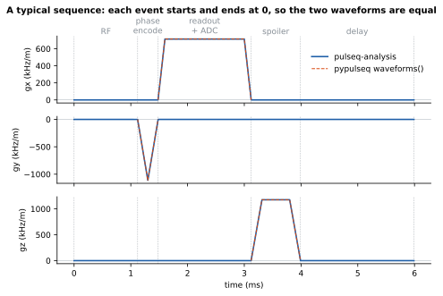
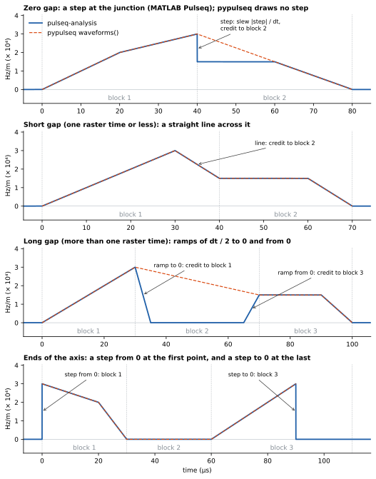
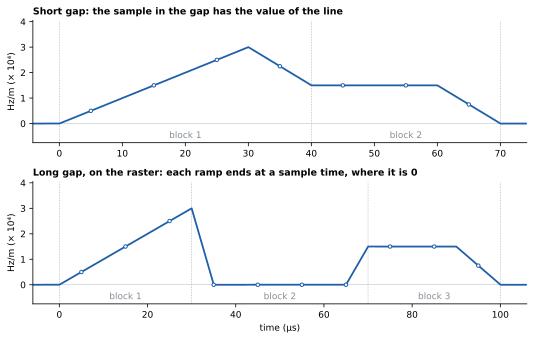

# How pulseq-analysis works

[`docs/usage.md`](usage.md) is the guide: it shows how to use the package for
its main tasks. This document gives the exact definitions behind its values,
the rules for the rare cases, and the algorithms and their cost. Read it when
you need to know exactly what a value is, why it differs from pypulseq, or how
long a call takes. (`docs/plans/implementation.md` is the plan of the first
version of the package, not this document.)

The names that the two documents give are the interface of the package. A
name that they do not give, or that starts with `_`, can change in any
release.

The package has three subpackages in layers, and a base of shared helpers at
the top level (`_equality`, `_validate`). A layer imports only from the layers
below it and from the base, and the base imports from no layer. An
import-linter contract (`[tool.importlinter]` of `pyproject.toml`, run by
`scripts/check`) enforces this order. From the top:

| Layer | Subpackage | Modules |
|---|---|---|
| The analyses | `pulseq_analysis.analyses` | `loading` (`load`), `registry`, `grad_peaks`, `grad_spectrum`, `pns_levels`, `series`, `safe`, `asc` |
| The waveforms | `pulseq_analysis.synth` | `decoding`, `scanner`, `snapshot`, `_played`, `seq_index`, `seq_utils`, `sampling`, `events`, `_events` |
| The files | `pulseq_analysis.seqfile` | `as_written`, `interpreters`, `reading`, `spec`, `from_pypulseq`, `model`, `errors` |

The last part of the path of each module is unique, so the two documents
write a module by it: `snapshot.Snapshot` is
`pulseq_analysis.synth.snapshot.Snapshot`. `load` is `pulseq_analysis.analyses.load`
(module `loading`). The class `Snapshot` stays in the waveforms layer, because the
waveform modules (`seq_index`, `_events`, `sampling`) keep their results on it;
`load`, which reads a file and emits the warning of a measurement, is in the
analyses layer.

Contents:

1. [The gradient waveform](#1-the-gradient-waveform)
2. [The measurements in detail](#2-the-measurements-in-detail)
3. [Algorithms and cost](#3-algorithms-and-cost)
4. [Kept results](#4-kept-results)
5. [The result objects](#5-the-result-objects)
6. [Argument checks](#6-argument-checks)
7. [What `load` does](#7-what-load-does)
8. [`Series`: checks and the array encoding](#8-series-checks-and-the-array-encoding)
9. [The oracles of the tests](#9-the-oracles-of-the-tests)

## 1. The gradient waveform

Each measurement of the gradients uses one waveform for each axis:
`gradient_peaks`, `block_gradient_values`, `pns_levels`, `gradient_spectrum`
and `GradientSampler`. It is the gradient waveform of MATLAB Pulseq
(`waveforms_and_times` in `Sequence.m`). This section gives it.

### 1.1 In practice

In most sequences, each gradient event starts and ends at 0 (a trapezoid, or
an extended trapezoid with ramps), or two events join at the same value at a
block junction (one gradient split across blocks). Then the waveform is the
events joined together, and it is 0 between them. It is the waveform that
pypulseq draws, and you do not need the rest of this section.

The rules of sections 1.3 and 1.4 change a value only when a sequence has one
of these:

- An event that starts or ends at a value that is not 0, next to a time with
  no event on that axis (a gap).
- Two events that join at a block junction with different values (a step).
- A first or a last event of an axis that starts or ends at a value that is
  not 0.

pypulseq's `add_block` accepts each of these only when the value (or the step)
is at most `max_slew * grad_raster_time`: one raster time of the largest slew.
For 150 T/m/s and a raster time of 10 µs, that is 1.5 mT/m (63 864 Hz/m). So
the amplitudes that these rules change are small. But a step of that size is a
slew of up to `max_slew`, so a step can be the largest slew of the file, and
it is part of the PNS. That is why the package uses these rules and does not
use pypulseq's line across each gap.

### 1.2 The events

In this section, `dt` is `snap.data.rasters.gradient`, the `GradientRasterTime` of
the file. `TIME_TOLERANCE` is 1e-9 s (`seq_utils.TIME_TOLERANCE`).

The waveform of one axis is a polyline. A gradient event gives its points at
the times `(block start + delay) + offset`, with its amplitudes. A trapezoid
has its corner points. An extended trapezoid has its corner points, and an
arbitrary gradient has its sample points, with `first` at its start and `last`
at its end. Between two points of one event, the waveform is a straight line.

The events are those of the decoding of the snapshot (`_played`): the
measurements take the gradients only through the decoding, and they decode
nothing themselves.

- **A decoded event**: the points that the decoding gives of the event, by its
  file ID, in the first block and axis that play it
  (`Decoding.gradient_points`, a method of the protocol `synth.Decoding`).
  - A decoding can decode one event otherwise in two blocks. Its
    `Decoding.gradient_variants()` then gives a variant for each block and
    axis: two cells with the same event and the same variant decode alike.
    Each pair of an event and a variant is an event of its own, with the
    points of its first cell. The pair of the first cell that plays the event
    keeps the file ID, and each other pair gets a key above the largest file
    ID (section 2.5). With None, every block that plays an event gets the
    points of the first.
  - `spec`: the decoded event of `events`, and its points by
    `seq_utils.gradient_offsets`. Its variants are None.
  - `cpp-siemens` (the plugin): the C++ reader's decoding of the event
    (`decodeBlock`). The reader decompresses the shapes of the gradients of a
    block into one buffer (one for the arbitrary gradients, one for the
    extended trapezoids, in the order gx, gy, gz), and a shape whose
    decompression writes fewer than its `num_samples` values keeps the values
    of the buffer. Such an event decodes after the events on the earlier axes
    of its block, so `cpp-siemens` gives it a variant for each set of those
    events. The files of MATLAB Pulseq and pypulseq have no such shape, and
    their variants are None (the plugin's tests check both on every
    fixture). The points are those between
    which the reader's `SeqBlock::gradientsAt` draws its straight lines: times
    in whole µs divided by 1e6, and the values that `gradientsAt` gives at them
    (a float32 amplitude times a float32 sample, D7.2). A gradient with a time
    shape runs from its first to its last sample, whatever `first` and `last`
    the file writes, and one whose first time is after 0 gets a point at its
    delay, where `gradientsAt` carries its first segment backwards (D4.5;
    `docs/findings-for-pulseq-checks.md`, 2.4). An event whose amplitude is 0
    is 0 everywhere, as `gradientsAt` gives it.
  - An event of length 0 (all its points at one time: a trapezoid with rise,
    flat and fall times 0, or an extended trapezoid whose time shape has one
    sample; both interpreters read both) has no segment. `gradients_at` gives
    it the value 0 at every time but that one, where a decoding can give
    another value (the reader gives the vertex of an extended trapezoid of one
    vertex). So its points keep their times and have the values 0, whatever
    values the decoding gives them, as in a block read through `gradients_at`
    (below). The measurements of such an event are those of the same event
    with the amplitude 0.
- **A block whose gradients the decoding gives with `gradients_at`**: a block
  with a gradient event that the decoding rotates by a rotation that is not the
  identity (`spec` from 1.5.1, `CppSiemens(rotation="apply")`; D2.18, D6.2), or
  that the field of view of the scanner session rotates (a block without NOROT,
  when the session rotates) or scales (a block without the scaling flag, when
  the session scales; section 7.0), and a block with an event that ends
  after the end of the block (`spec` rejects it,
  `block.event-too-long`; `cpp-siemens` plays such a file, D7.4, and
  `oversampling="preserve"` stretches an oversampled gradient, D6.1). The
  package does not rotate: the decoding's `gradients_at` does. The gradients
  of such a block are straight lines between the times of the points of its
  events, up to the end of the block (`gradients_at` is 0 after it), so each
  axis gets one event with a point at each of these times and the value of
  `gradients_at` there. There are always two times or more, so each event has
  two points or more:
  - When an event goes on after the end of the block, or every point of the
    events is at one time (an event of length 0: the reader can decode one,
    and `spec` reads a trapezoid with rise, flat and fall times 0), the end of
    the block is a time. Its value is the one just before the end.
  - When no point is before the end, the block start is a time too. An event
    can lie wholly after the end of its block (`cpp-siemens` reads such a
    file; the reader plays 0 on that axis in the block).
  - A block of duration 0 has the times 0 and 0.

  At a step of an event (it starts or ends at a value that is not 0, or has two
  points at one time), the event has two points at
  that time: the value just before and the value just after, each the
  straight line of `gradients_at` at two times inside the next segment,
  carried to its end. A rotated block (by its rotation or by the field of view)
  has an event on each axis; another block on the axes that have an event. The
  block table numbers these events after the events of the file (section 2.5).

`test_played.py` checks, on every fixture, that the straight lines of the
points equal `gradients_at` at the middle of each segment and at each point that
is not a step, to 1e-7 of the largest value; the plugin's tests check the same
for each setting of `cpp-siemens` (1e-7 is the float32 rounding of the reader's
values).

### 1.3 The gaps

Take two consecutive events of one axis. The blocks between them have no event
on the axis. `last_time` and `last` are the time and the value of the last
point of the earlier event. `first_time` and `first` are the time and the value
of the first point of the later event. The gap is `first_time - last_time`.

| Gap | Rule | Waveform |
|---|---|---|
| Zero gap | The gap is at most `TIME_TOLERANCE`. | No point. When `first` is not `last`, the waveform has a step from `last` to `first` at `first_time`. The value at the time of the step is `last`. |
| Short gap | The gap is more than `TIME_TOLERANCE` and at most `dt + TIME_TOLERANCE`. | No point. The waveform is the straight line from the last point to the first point. |
| Long gap | The gap is more than `dt + TIME_TOLERANCE`. | A ramp to 0 from the last point to the time `last_time + dt / 2`, when `last` is not 0. A ramp from 0 from the time `first_time - dt / 2` to the first point, when `first` is not 0. The value is 0 between the ramps. |

A value of 1e-6 Hz/m or less also gets its ramp. MATLAB Pulseq sets such a
value to 0 and adds no ramp. The difference is at most 1e-6 Hz/m in half a
raster time.

### 1.4 The ends of the axis

The value is 0 before the first point of the axis and after its last point. A
first value that is not 0 is a step from 0 at the first point. A last value
that is not 0 is a step to 0 at the last point (the bottom panel of the figure
above).

### 1.5 The slew

The slew of a segment (a segment of an event, a ramp or a line) is its slope.
The slope of a ramp is `2 * |value| / dt`. The slope of the line across a short
gap is `|first - last| / (first_time - last_time)`. A segment shorter than
`TIME_TOLERANCE` has no slope. The slew of a step is `|step| / dt`. The scanner
plays a step in one raster time, so a step is a slew like a slope. The slew of
an axis is the largest of these values.

### 1.6 The credit of each item to a block

A value, a slew and an RMS integral have the credit of a block (a play index).
The annotations of the figure above show the credit. The credit is:

- The points and the segments of an event: the block of the event.
- A ramp to 0: the block of the earlier event, also when the ramp is after the
  end of that block.
- A ramp from 0: the block of the later event.
- A step across a zero gap and the line across a short gap: the block of the
  later event.
- The step before the first point of the axis: the block of the first event. The
  step after the last point: the block of the last event.

The time of a segment is its start. For a segment that the edge of a range
cuts, it is the start of the cut. The time of a step is its time: `first_time`
for a step across a zero gap, and the time of the point for the step at an end
of the axis. The time of a ramp to 0 is `last_time`, the time of a ramp from 0
is `first_time - dt / 2` and the time of a line is `last_time`. When several
items have the largest value, the first of them in play order gets the credit.
The step or the line into an event is before the segments of that event.

### 1.7 A range

A range is `[lo, hi]` (the whole file, or a window of `gradient_peaks`). A
segment that crosses an edge of the range is cut at the edge. The value at the
edge is found by linear interpolation. A step is in the range when
`lo <= t < hi` and `t < end_s - TIME_TOLERANCE`, with `end_s` the end of the
sequence. So a step at the start of a window is in it, and a step at the end of
a window is not. The step after the last point of the axis is at the time of
that point. When that point is within `TIME_TOLERANCE` of the end of the
sequence, no range has the step: the whole file does not have it. The result
does not depend on whether `(start + delay) + shape_dur` rounds to `end_s` or to
one ulp before it.

### 1.8 The RMS and the vector peak

The RMS integral is the integral of the square of the polyline, with the ramps
and the lines. A step adds nothing.

The vector peak is the largest `sqrt(gx^2 + gy^2 + gz^2)` at the union of the
times of the points of the three axes. The ramp points are points. At a time,
the value is found on both sides of the time, so a step has two values. The
credit goes by the time, not by the axis. The value before the time goes to the
first block that ends at or after the time. The value after the time goes to
the last block that starts at or before the time. Each is within
`TIME_TOLERANCE`. Of equal values, the earliest time wins.

### 1.9 The difference from pypulseq

pypulseq's `Sequence.waveforms()` joins the points of the events of an axis
and does nothing at a gap. `get_gradients()`, `calculate_pns` and
`calculate_gradient_spectrum` use these points. So pypulseq draws a straight
line across each gap, also across a long gap. At a zero gap it drops the first
point of the later event, so it has no step. The dashed lines of the figure
above show it.

The two waveforms are equal when the file has no end that is not 0 next to a
long gap, and no step at a block junction (section 1.1). pypulseq's
`calculate_pns` and `calculate_gradient_spectrum` then give the values of the
package, with the units of [`docs/usage.md`, section 9](usage.md#9-units-and-gamma).

## 2. The measurements in detail

### 2.1 `gradient_peaks` and `block_gradient_values`

The values are the largest values of the waveform of section 1, over the
whole file, over a window, or for each block:

- The peak is the largest absolute amplitude.
- The slew is the largest of the slopes of the segments (of the events, the
  ramps and the lines) and of the steps (section 1.5).
- The RMS is the root of the mean of the square of the waveform over the range.
- The vector peak is the largest magnitude of the three-axis vector
  (section 1.8).

An axis with no event in a block has the amplitude 0 there. When several
blocks have the largest value, the first of them in play order gets the
credit. A largest value of 0 gives no block (`None`) and the time 0.0.

**A NaN.** A plugin can read a NaN of a file (an amplitude `nan`, which `spec`
rejects, `syntax.number`), and then the waveform is NaN where that event plays.
A NaN propagates: it is larger than every number, and two NaN are equal, so the
rules of the largest value and of the credit hold as they are.

- An event with a NaN point has a NaN peak, at the time of its first NaN
  point. An event with a NaN segment has a NaN slew, at the start of its first
  NaN segment. Its RMS integral is NaN.
- A step, a junction, a line or a ramp with a NaN end (a NaN at the first or
  the last point of an event) has a NaN slew.
- The vector peak is NaN at the first time of its candidates (section 1.8)
  where the vector is NaN.
- So the peak, the slew, the RMS and the vector peak of a range with a NaN are
  NaN. The first block in play order with the NaN gets the credit (for the
  vector peak, the block of the earliest time), at the time of its first NaN.
  In a window, that time can be an end of the range, where the range cuts a
  NaN segment.

The values of a range with no NaN do not change.

**The slew block.** `AxisResult.slew_time_s` is the start of the segment of
the largest slew (the start of the range when the range cuts the segment), or
the time of that step. `slew_block` is the block of its credit (section 1.6):
the block of the event of the segment; the later block for a step, a line and
a ramp from 0; the earlier block for a ramp to 0; and the block of the last
event for the step after the last point of the axis.

**A window.** `range_s` is the window with each end clipped to `(0.0, end_s)`
of the sequence, so its start is never after its end. A window that is past an
end of the sequence by less than `seq_utils.TIME_TOLERANCE` has the range
`(end_s, end_s)` (or `(0.0, 0.0)`), of length 0, with the `reason`
`seq_index.NO_GRADIENTS_IN_WINDOW` and the zero values. A segment that crosses
an end of the window is cut there, and a step is in the window by the rule of
section 1.7. The `reason` is `None` when the range has a part of a gradient
event, or a ramp, a line or a step with a value that is not 0.

A call with a window uses the values of each block that the snapshot
keeps (the peak, the slew, the junction, the RMS integral and the vector peak,
with their times) for the blocks that are whole in the window. It makes the
other blocks of an edge of the window from the exact waveform. The time range
of a block is the span of the block and of its items on the three axes: its
event, its ramps, the line into it and the step after the last point of the
axis. The line across a short gap starts at the last point of the earlier
event, up to `dt + TIME_TOLERANCE` before the event, and can cross blocks that
are shorter than `dt`. A ramp to 0 ends half a raster time after its event. A
block whose time range an edge of the window crosses is made from the exact
waveform, so an edge is not limited to one or two blocks.

**The values of each block.** In `BlockGradientValues`:

- `slew_hz_per_m_per_s` is the largest slope of a segment of the event of the
  block or of its ramps. The ramp to 0 after the event and the ramp from 0
  before it are in the slew of this block. So is the step after the last point
  of the axis, in the block of the last event, when that point is more than
  `TIME_TOLERANCE` before the end of the sequence.
- `junction_hz_per_m_per_s` is the step into the event of the block across a
  zero gap, `|last - first|` divided by `snap.data.rasters.gradient`, or the slope of
  the line into it across a short gap, `|last - first|` divided by the gap. It
  is 0 for a long gap, and for a block with no event on the axis. For the first
  event of the axis it is the step from 0. Its time is the time of the first
  point of the event for a step, and the time of the last point of the earlier
  event for a line. There is no field for it.
- A block with no event on an axis has the peak, the slope and the junction 0
  there, at the time `start_s`.
- The vector peak of a block goes by time (section 1.8), so a block with no
  event can have a vector peak that is not 0: the value of a ramp or a line at
  its start or its end.

The largest of each amplitude array is the value of `gradient_peaks` for the
whole file. Its slew is the larger of the largest segment slew and the largest
junction. The first play index of a largest value is the block of that value.
For the vector peak, it is the block with the earliest `vector_peak_time_s` of
the blocks that have the largest value.

### 2.2 `pns_levels`

**The samples.** The model takes one sample of each axis for each gradient
raster time `dt = snap.data.rasters.gradient`. Sample `k` is at the time
`(k + 0.5) * dt`. The value of a sample is the waveform of section 1 at that
time: a line across a gap of one raster time or less, a ramp to 0 and a ramp
from 0 across a longer gap, and a step at a block junction.

The samples of a block start at the start of that block, so a block gives the
same samples wherever it is in the sequence. Only the samples in a gap use the
sum of the durations of the blocks before them. When every event is on the
edges of the gradient raster, a ramp of half a raster time ends at a time of a
sample, where it is 0. So on the raster, a long gap changes no sample, and a
short gap gives its samples the value of the line.

`PnsLevels.on_raster` is `True` when the duration of each block is a whole
number of samples (`sampling.raster_block_lengths`). Otherwise the samples come
from the waveform of the whole file at the same times (`GradientSampler.sample`).

**The model.** The SAFE model of the module `safe` (ported from the pinned
pypulseq fork) runs on the Hz/m samples, and reads no gamma. The value of an
axis is the output of the model for that axis, and the total of a sample is
`sqrt(x^2 + y^2 + z^2)` of the three values. A PNS value is in Hz/T: the
fraction of the stimulation limit times |γ|. pypulseq's `seq.calculate_pns`
divides by `seq.system.gamma`, so it gives fractions. `pns_levels` equals it,
times |γ|, for a sequence where the two waveforms are equal (section 1.9).

**The peak.** `peak_time_s` is the time of the first sample whose total is
within `pns_levels.PEAK_TOLERANCE` (a fraction) of the peak. It is `None` when
the peak is 0: with `NO_GRADIENTS`, and for gradients that all have the
amplitude 0 (then the model does not run a second time to find the time).

**A NaN.** When a sample of the gradients is NaN (section 2.1, "A NaN"), its
total is NaN, and so is every later total: the filters of the model carry it.
A NaN propagates: `peak_hz_per_t` is NaN, and `peak_time_s` is the time of the
first sample whose total is NaN. The peak of an axis is NaN when a value of the
axis is NaN, and a bin of the level with a NaN total has the minimum and the
maximum NaN.

**The runs above a threshold.** `above[t]` has each run of consecutive samples
whose float64 total is at or above `t`, in time order. A run starts at
`first * dt` and ends at `(last + 1) * dt`, the edges of its samples, so a run
of one sample has `end_s - start_s == dt`. A tuple is empty when
`peak_hz_per_t` is below its threshold. Otherwise its largest
`PnsInterval.peak_hz_per_t` is `peak_hz_per_t`. All thresholds are found in
one pass. A NaN total is at or above no threshold, so with a NaN peak the
runs are those of the finite totals before the first NaN, and the largest of
a run is not the peak.

**The bins of the level.** `bin_samples_for(num_samples, dt, bin_s)` gives the
whole number of samples of a bin. When `bin_s / dt` is within
`ON_RASTER_TOLERANCE` (1e-6) of a whole number, that is the number, so
`bin_s=0.01` gives 1000 samples at the 10 µs raster. Else it is the number
rounded down: `bin_s=10.0 / 1624` gives 615 samples. The bin has at least one
sample, so a `bin_s` shorter than `dt` gives bins of one sample. When the level
would have more than `pns_levels.MAX_BINS` (2,000,000) bins, the bins are
longer, so that the level has at most that many. Only the level depends on
`bin_s`: the summary and the intervals do not. The bin of a result is
`bin_samples * dt_s`. Each total of a bin is in
`[level_min_hz_per_t, level_max_hz_per_t]` of the bin, and the last bin can
have fewer samples.

**The hardware.** `safe.SAFE_FIELDS` is the nine fields of each axis of a SAFE
hardware struct, in the order of `safe_example_hw` and `asc_to_hw`.
`safe.SafeHardware` and `safe.SafeAxis` check the fields
when they are made, and `SafeHardware.from_namespace` converts the struct of
`asc_to_hw`. Section 6 gives the checks of the struct. Two pairs of one `.asc` file,
whatever the spelling of its path, have the same label and values, so
`pns_levels` keeps one result for them.

### 2.3 `gradient_spectrum`

The waveform of section 1 is sampled with `GradientSampler.sample`. The method
is that of pypulseq's `calculate_gradient_spectrum`:

- Each window is a Hann window of `window_s` (50 ms by default), and the
  windows overlap by 50 % (`nwin // 2`). The mean of each window is removed.
  The spectrum of a window is the magnitude of its FFT of length
  `nfft = round(frequency_oversampling * nwin)`, scaled as an amplitude
  spectral density: thus the unit has √Hz.
- The gradients are sampled to the end of the sequence
  (`sampling.sequence_samples` gives the number of samples). The sampled
  waveform has half a window of zeros at the start. At the end it has half a
  window or more: the fewest zeros that make the padded waveform one window
  plus a whole number of hops long. (A hop is the step between two windows,
  25 ms by default.) Thus each sample, the last one too, is within half a hop
  of the centre of some window, and a gradient at the end of the sequence is
  attenuated by the window no more than one in the middle.
- In each window, the three axes combine as the RSS (the root of the sum of
  squares). The spectrum of an axis is its maximum over the windows. The RSS
  spectrum is the maximum over the windows of the RSS.
- The windows go through the FFT in chunks of 256 windows, so the memory does
  not grow with the length of the sequence.

These arguments of pypulseq are not arguments here:

- The overlap. pypulseq has no argument for it. It stays 50 %.
- `combine_mode` and `use_derivative`. They change what a value is, for
  example a spectrum of the slew rate. A later quantity gets its own function.
- `time_range`. The spectrum is of the whole sequence, as `gradient_peaks`
  without `window`.
- `acoustic_resonances`. The resonances are data of a target, not of a
  sequence.

### 2.4 The sampler and the number of samples

`GradientSampler.sample(axis, t)` gives the values at the sorted times `t`.
They are the straight lines between the points of all the events of the axis,
with the ramps to 0 and from 0 across a long gap, and 0 before the first point
and after the last point. The value at the time of a step is the value before
the step.

`GradientSampler.block_samples(axis, first, stop, dt, *, skip=0, count=None)`
gives the samples of the play indexes `first` to `stop - 1`, each block on its
own at the times `(j + 0.5) * dt` from its start, with the values of its own
event and 0 outside it. A sample at a time after the last point of the own
event by `TIME_TOLERANCE` or less has the value of that point: the time of the
point and the time of the sample are two float sums, and they can differ by one
ulp when they are the same time. A sample in a gap has the value of the
waveform there: the line across a short gap, or the ramp of a long gap. This holds in any
block, also in a block with no event on the axis. The time of a sample in a gap
is `start + (j + 0.5) * dt`, with `start` the sum of the durations of the
blocks before the block, so it has the float drift of that sum. The own-event
samples have none. This is what the PNS model uses. `skip` and `count` (0 or
more) choose a part of that range: the result is, bit for bit, the samples
`skip` to `skip + count - 1` of the result for the default arguments, and
`count=None` gives all the samples after `skip`. The first and the last block
give only their samples inside the part, so the cost and the memory do not
grow with the length of a block that the part cuts. It raises `ValueError`
when a block of the range is not a whole number of samples long, or when
`skip` or `count` is negative or `skip + count` is more than the samples of
the range.

`sampling.raster_block_lengths(index, dt)` gives the number of samples of each
block, `round(duration / dt)`, and one bool for all the blocks: whether every
block is within `sampling.ON_RASTER_TOLERANCE` samples of a whole number.

`sampling.sequence_samples(index, dt)` gives the number of samples of the
whole sequence, as an `int`. `pns_levels` and `grad_spectrum` both use it.
When every block is on the raster, it is the sum of the block lengths.
Otherwise it is `ceil((index.end_s - 1e-10) / dt)`, and at least 0.

### 2.5 The block table

`sequence_index` reads the block table of the snapshot's data
(`SequenceData.blocks`) and the actual durations of its decoding
(`Decoding.block_durations`: the stored ones, except for a block whose soft
delay the scanner session sets) as arrays. It numbers the unique events of each kind from 1, in the order of
their first use: block by block in play order, and in one block in the order
gx, gy, gz. The three gradient axes share one number space, so one event that
plays on x and on y has one number. The event columns use the smallest of
uint8, uint16 and uint32 that holds the number of unique events.

The gradient events are those of section 1.2: the file IDs of the events of
the file, a key above the largest file ID for each other variant of an event
(`Decoding.gradient_variants`), and for a block whose gradients come from
`gradients_at`, a key for each axis above those (one set of keys for each distinct such
block: the same events, rotation, flags of the field of view and duration). So
in a rotated block the three axes have events of their own. The IDs of the file are kept: two equal
rows with different IDs are two events (pypulseq's reading merged them).

## 3. Algorithms and cost

This section gives the algorithm of each call, its cost, and measured times.
Use it to know how long a call takes on a large sequence, and what makes it
slow.

### 3.1 Notation

| Symbol | Meaning |
|---|---|
| B | The number of blocks. |
| K | The number of unique gradient events (`index.grad_first.size`). |
| P | The number of points of the unique gradient events. |
| P_play | The number of points of all the gradient events that play: the sum, over the blocks, of the points of the events of the block. |
| U | The number of unique gradient events of the blocks that play. |
| S | The number of samples on the gradient raster: the duration divided by `dt`. A sequence of 2 minutes at 10 µs has 12 million. |
| Q | The number of times of a call of `sample`. |
| nwin, nfft | The samples of a window of the spectrum, and the length of its FFT. |

The time of a call grows with one of three sizes: the number of blocks (B,
P_play), the number of unique events (K), or the duration (S). A sequence that
repeats a TR has few unique events, so K is small for it. A sequence with a
new gradient in each TR (for example a phase-encode table with no repeat) has a
K that grows with B.

### 3.2 The shared work

Each gradient measurement starts from some of the same parts. The package makes
each part one time for each snapshot and keeps it (section 4), so only the first
measurement that needs a part pays for it. `load` is before all of
them: it reads the file through the interpreter (for a `pp.Sequence`, it
writes the sequence with pypulseq's writer first), and decodes it (for `spec`,
every event of the model; for `cpp-siemens`, `decodeBlock` of every block,
which gives its verdict and keeps no block; the decoding object decodes a
block when one is asked for, and keeps it). Its cost is in the
first two rows of the table of section 3.5.

- **The played gradients** (`_played.played_gradients`). The event of each
  block and axis (section 1.2): one `np.unique` of the gradient columns, and
  the points of each unique event, in a Python loop. For `cpp-siemens`, each
  event costs one `GetBlock` and `decodeBlock` of the first block that plays
  it: a block that is the first to play the events of two or three axes is
  decoded again for each of them, although the reader keeps it. These calls of
  `gradient_points` take 0.02 s for 1000 calls, and 0.10 s for 32,000
  (measured on 2026-10-14). Then, only for the blocks whose gradients come
  from `gradients_at`, one call of `gradients_at` for all of them. Time
  O(B log B + K + P), plus O(the points of those blocks).
- **The block table** (`sequence_index`). The block table of the data and its
  durations as arrays, and the played gradient columns, then numpy: a
  cumulative sum for the starts, and a lookup table over the event IDs that
  numbers the events in the order of their first use (`np.unique` of the used
  IDs when the largest ID is more than 16 times the number of entries). Time
  O(B), or O(B log B) with `np.unique`; memory O(B), also for a large ID. The
  first call of `sequence_index` makes the played gradients too, so it takes
  time O(B log B + K + P) and memory O(B + P).
- **The points of the unique gradient events.** The points of the played
  gradients of each unique event, into flat arrays for all the events, which
  all the measurements share. Time O(K + P). This is a part whose cost grows
  with K (section 3.5).
  The first call of `gradient_peaks` also makes the values of each unique event
  (`_event_values`), with numpy over the pooled points of all the events: less
  than 0.1 µs for each of them. So that first call grows by about 9 µs for each
  unique event in all.
- **The gaps of each axis.** The consecutive events of an axis, the length of
  each gap between them, and its kind (section 1.3), give the parts of the
  waveform in the gaps: the line across a short gap and the ramps of a long
  gap. Vectorised. Time O(M log M) for the M blocks with an event on the axis.
  Only `GradientSampler.block_samples` uses these parts, and so only
  `pns_levels` (on the raster) and `block_samples` of a `gradient_sampler`
  share them. `GradientSampler.sample`, and so `gradient_spectrum`, does not:
  each sampler finds the kind of each gap of an axis itself, in its first call
  on that axis (section 3.3). `gradient_peaks` and `block_gradient_values` do
  not either: they classify the gaps of each axis themselves, with the values
  of each block, in a vectorised step of their first call.

### 3.3 Each call

**`gradient_peaks(snap)` and `block_gradient_values(snap)`.** The first call
makes the values of each block, and keeps them for the two functions and for
all windows:

1. The peak, the slew and the RMS integral of each unique event, from its
   points. Vectorised over the pooled points of the K events (a `reduceat` over
   the points of each event): less than 0.1 µs for each event.
2. The values of each block: the values of its event on each axis, by index
   into the values of step 1, with the ramps, the lines and the steps of the
   gaps. Vectorised. Time O(B).
3. The exact vector peak. The polyline of each axis over the whole file, from
   the points of all the events that play, and the sorted union of the times of
   the points of the three axes (a stable sort that merges the sorted times of
   each axis). Time O(P_play log P_play). For a sequence with
   few unique events, this step is the largest part of the first call.
4. The result of the whole file: the first largest value of each array.

`block_gradient_values` then copies the arrays of the blocks, in time O(B).
Time of the first call O(K + B + P_play log P_play), memory O(B + P_play).

**`gradient_peaks(snap, window=...)`.** A binary search finds the blocks of the
window in the kept arrays. The blocks that are whole in the window give their
kept values (a vectorised largest value and sum over them). The blocks whose
time range an edge of the window crosses (section 2.1) are made from the exact
polyline of their events. Time O(log B + blocks in the window), with no term
for K or for the blocks of the file. The work at the edges is most of the
time: a window of 5000 blocks takes about the time of a window of one TR.

**`GradientSampler.sample(axis, t)`.** A binary search finds the blocks from
`t[0]` to `t[-1]`. The points of their events, with the ramps of the long gaps,
make the polyline of that range, and `np.interp` gives the values. Time
O(log B + points of the events in the range + Q), memory O(Q + those points).
This leaves out a cost of the first call: `gradient_sampler(snap)` makes a
new sampler for each call, and the first `sample` of a sampler on an axis finds
the events, the kinds of the gaps and the ramps of that axis
(`_events.axis_events`, `gap_kinds` and `ramps`, time O(B), kept by the
sampler). `sample` does not use the gaps that the snapshot keeps (section 3.2).

**`GradientSampler.block_samples(...)`.** The samples of each block of a
range, on the raster. The samples of one event do not depend on the length
of its block (a block of n samples has the first n of them), so the sampler
makes them one time for each unique event and gathers them into all the blocks
with one indexed copy. The samples of the gaps are then written over them,
vectorised. Time O(samples of the range + blocks of the range), plus the
samples of each new event one time. A sequence that repeats a TR has few
unique events. The first `block_samples` of a sequence on an axis also finds
the gaps of that axis (section 3.2), with the events, the kinds of the gaps
and the ramps of the axis, as `sample` does; the snapshot keeps the gaps, so a
later sampler does not find them again.

**`pns_levels`.** The model runs on chunks of about 30,000 samples, or of one
bin when a bin is longer (a chunk is `bin_samples * ceil(_CHUNK_SAMPLES /
bin_samples)` samples, so a `bin_s` of 2 s gives chunks of 200,000 samples). The
memory does not grow with the duration:

1. `block_samples` gives the samples of the chunk on each axis. A sequence
   that is not on the raster uses `sample` instead.
2. The SAFE model: for each axis, the slew (the difference of the samples)
   goes through three first-order recursive filters (`scipy.signal.lfilter`),
   with the state of the filters carried from the chunk before.
3. The total of each sample, the least and the greatest total of each bin,
   and the runs at or above each threshold.

After the last chunk, the model runs again on the one chunk of the peak, to
find the time of the peak. Time O(S), plus O(S) for each threshold (a
comparison, and one `PnsInterval` for each run: about 7 % for each of 3
thresholds inside the range of the levels, at 1,000,000 blocks), plus O(U) for
the samples of the unique events that `block_samples` makes one time for each event (section 2.4). Memory O(chunk) for the samples (at the default `bin_s`, about
6 MB; 34 MB for a `bin_s` of 2 s), plus the bins (at most `MAX_BINS`, 16 MB), the
runs, and the cache of `block_samples`, which holds the samples of each unique
event up to its last point, 8 bytes for each sample: 16 MB for 1000
different arbitrary gradients of 2000 samples.

The cost grows with the duration, not with the number of blocks, when the
sequence has few unique events: one block of 120 s took 0.83 s, and 1200 blocks
of 0.1 s (12 million samples in each case) took 0.86 s. A sequence with many
unique events pays for each of them, about 20 µs for each one (section 3.5).

Each call of `pns_levels` makes a new sampler, so a call with other arguments
(another hardware, for example) makes the cache of `block_samples` again; the
snapshot keeps the gaps (section 3.2). A sampler kept between the calls would
save 2 % of a call on a file of 40,000 blocks, and 13 % on a spiral file
(measured on 2026-10-14): most of the time is the filling of each chunk, which
a cache cannot avoid without keeping the whole waveform.

**`gradient_spectrum`.** The windows go through the FFT in chunks of 256
windows:

1. `sample` gives the samples of the windows of the chunk on each axis, at the
   raster times.
2. A strided view gives the windows, with no copy. The mean of each window is
   removed, and the Hann window is applied.
3. `scipy.fft.rfft` of length nfft, in one thread. Only the frequencies up to
   `max_frequency_hz` are kept.
4. The running maximum over the windows, for each axis and for the RSS.

There are about `2 * S / nwin` windows, so the time is
O(S · frequency_oversampling · log nfft): the FFT is most of it. Memory
O(256 · nfft) for one chunk: about 54 MB with the default arguments at the
10 µs raster. The spectrum samples each chunk one time, and the windows are a
view of those samples with no copy. Only the overlap of two chunks, one window
less one hop (half a window) for each 256 windows, is sampled twice.

**The other calls.** `Series` checks, `to_obj`, `from_obj`, `encode_array` and
`decode_array` takes time O(n) for n values. `asc.read_gradient_asc` takes time
O(the size of the file and of its included files). `registry.registry()` reads the entry
points of the installed packages. An analysis `compute` is its function.

### 3.4 Summary

| Call | Time | Memory | Grows most with |
|---|---|---|---|
| `sequence_index` (with the played gradients) | O(B log B + K + P) | O(B + P) | blocks, unique events |
| First gradient measurement (the block table, the played gradients and the points of the unique events) | O(B log B + K + P) | O(B + P) | blocks, unique events |
| `gradient_peaks(snap)`, `block_gradient_values` | O(K + B + P_play log P_play) | O(B + P_play) | blocks |
| `gradient_peaks(snap, window=...)` | O(log B + blocks in the window) | O(blocks in the window) | (almost constant) |
| `GradientSampler.sample` | O(log B + points in the range + Q); the first call on an axis of a new sampler also O(B) | O(Q + points in the range) | times asked |
| `pns_levels` | O(S + U) | O(chunk + bins + samples of the U events) | duration, and unique events |
| `gradient_spectrum` | O(S · oversampling · log nfft) | O(256 · nfft) | duration |

### 3.5 Measured times

These times are from an Apple M1 Max, on 2026-10-13, with Python 3.12.14,
numpy 2.5.3 and the pinned pypulseq 1.5.0.post1, with the code of `main` at
`6479eab` (the scanner session included), through `spec`. The sequences are those of
`tests/scale_sequences.py`: a GRE TR of 5 blocks (6 ms), with a phase-encode table
of 256 entries (`build_repeating`) or with a new phase-encode event in each TR
(`build_worst`). The 1,000,000-block column is one run; the others the minimum
of three.

| Call | 100,000 blocks, 120 s, K = 258 | 100,000 blocks, 140 s, K = 20,002 | 1,000,000 blocks, 1198 s, K = 258 |
|---|---|---|---|
| `load(seq)` | 0.58 s | 1.92 s | 5.79 s |
| `load(path)` | 0.07 s | 0.84 s | 0.72 s |
| `sequence_index` | 18 ms | 78 ms | 0.21 s |
| `gradient_peaks(snap)`, first call | 46 ms | 63 ms | 0.52 s |
| `block_gradient_values`, after it | 0.5 ms | 0.5 ms | 3.6 ms |
| `gradient_peaks`, a window of 1 block | 0.4 ms | 0.4 ms | 0.3 ms |
| `gradient_peaks`, a window of 1 TR | 0.7 ms | 0.7 ms | 0.7 ms |
| `gradient_peaks`, a window of 1000 TRs | 0.8 ms | 0.8 ms | 0.8 ms |
| `sample`, 1,000,000 times | 6 ms | 6 ms | 23 ms |
| `gradient_spectrum` | 0.89 s | 1.04 s | 8.7 s |
| `pns_levels` | 0.87 s | – | 8.9 s |
| `pns_levels`, 3 thresholds (20, 25 and 30 MHz/T, below the peak of 35.2 MHz/T) | – | – | 11.1 s |

`load(seq)` writes the sequence with pypulseq's writer before the read
(`read_pypulseq`, task R15): the writer is most of its time. `load(path)` of
`spec` decodes every event of the file, so it grows with K. `sequence_index`
includes the played gradients (section 3.2), which take the points of each unique
event. With `cpp-siemens`, `load(path)` takes 0.42 s (K = 258) and 0.61 s
(K = 20,002) for 100,000 blocks, because the reader decodes every block to give its
verdict, and `sequence_index` 18 ms and 0.14 s (one `decodeBlock` for each unique
gradient event); the other rows are within 10 % of those of `spec`.

`scripts/time_measurements.py` builds a new sequence for each repeat, and
gives the minimum over the repeats. From `sequence_index` on, each of its rows
is the time of the call after the rows above it, on one snapshot: the first
call of `gradient_peaks` does not include the block table.
`scripts/time_pns_levels.py` times the model with no kept result, and without
the block table. Each script with `--json OUT` writes its results with the
machine and the commit.

## 4. Kept results

A `Snapshot` (`load`, see the module docstring of `pulseq_analysis.synth.snapshot`)
holds the `SequenceData` of an interpreter and its decoding, which do not change,
and a dict of kept results. Each measurement keeps its result in the dict on its
first use, under a key made from the measurement and its arguments. There is no
stamp and no check of a change: the data of a snapshot cannot change, so a kept
result is never old.

| Function | Key of the kept result |
|---|---|
| `sequence_index` | the snapshot |
| `_played.played_gradients` | the snapshot |
| `gradient_peaks` | the snapshot, for `window=None` only |
| `block_gradient_values` | the snapshot |
| `pns_levels` | the snapshot, hardware, tuple of thresholds (in its order) and `bin_s` |
| `gradient_spectrum` | the snapshot and tuple of its three arguments |

A second call with the same arguments gives the same object. A result with a
window is not kept, because a caller can ask for many windows, but it uses the
kept values of each block. The points of the unique gradient events are kept
too, and all the gradient measurements share them. The gaps of each axis are
kept with the points, but only `GradientSampler.block_samples` (so
`pns_levels` on the raster, and `block_samples` of a `gradient_sampler`) uses
them: `GradientSampler.sample` (so `gradient_spectrum`), `gradient_peaks` and
`block_gradient_values` classify their gaps themselves.

A different `bin_s` is another kept result of `pns_levels`, also when it gives
the same `bin_samples`. The same thresholds in another order are another kept
result too, because the order of `above` is the order of `thresholds_hz_per_t`.

**What keeps a result true.** `load(path)` reads the file, and `load(seq)`
reads the text that pypulseq's writer makes of `seq`: the snapshot holds no
object of the caller. So a change of `seq` after `load` (`add_block`,
`mod_grad_axis`, a direct write into a library) does not change the snapshot.
The `SequenceData` is immutable (its arrays are read-only), and so are the
decoded events of `spec`. The decoding of `cpp-siemens` holds the reader's
object, which decodes a block on request and keeps it; nothing that a caller can
reach changes it.

A snapshot is equal only to itself, and its hash is the identity hash, so it can
be the key of a dict. A copy from `pickle` or `copy.deepcopy` is a new snapshot
of the same data (decoded again) with no kept results: it makes them again. The kept
results go away with the snapshot. `gradient_sampler(snap)` makes a new sampler
for each call, from the kept points and gaps.

**The rasters.** The `rasters` of an analysis are the rasters of the file
whose value changes the value of the analysis. The decoding of each interpreter
makes each block duration (`Decoding.block_durations`) from the
`BlockDurationRaster`, and each analysis reads the durations. The block table
(`seq.index`) does not use the `GradientRasterTime`. The gradient, PNS and
spectrum measurements use both rasters.

## 5. The result objects

**Equality.** `SequenceIndex`, `BlockGradientValues`, `GradientPeaks`,
`PnsLevels`, `GradientSpectrum` and `Series` compare by value: `==` compares
each field, an array by its dtype, its shape and its values (a NaN equals a
NaN), and a dict with its keys in order (for a `Series`, also the keys of
`meta`). So the indexes of two reads of one file are equal, and the same
thresholds in another order give a `PnsLevels` that is not equal. The read-only
flag does not count, so a copy from `pickle` or `copy.deepcopy` equals the
original. These classes are not hashable (`hash(x)` raises `TypeError`). The
other frozen dataclasses (for example `AxisResult` and `PnsInterval`) have the
`==` and the hash of `dataclasses`.

**Read-only.** A result can be shared (section 4), so the arrays of a result
are read-only: a change in place, such as `index.start_s[0] = 1.0`, raises
`ValueError`. This holds also for a result with `NO_GRADIENTS`. The arrays of a
`BlockGradientValues` are its own arrays, not views of the index. The dicts of
a result are `FrozenDict`s (`series.FrozenDict`): subclasses of `dict` whose
methods that change them (`d[key] = x`, `del d[key]`, `update`, `pop` and the
like) raise `TypeError`. `FrozenDict(...)` is filled by `__new__`, and its
`__init__` does nothing, so `d.__init__(...)` does not change it. The methods of
`dict` itself (`dict.__setitem__(d, key, x)`, `dict.__init__(d, ...)`) cannot be
blocked, and they change it. A `FrozenDict` is still a `dict` for `isinstance`,
`json.dumps`, `pickle` and `copy.deepcopy`, and it equals a `dict` with the
same items in any order (it has the `==` of `dict`). Only the `==` of a result
checks the order of the keys of its dicts. Make a copy to change one:
`np.array(a)`, `dict(d)`.

## 6. Argument checks

**Number arguments.** A number argument (a threshold, `bin_s`, the arguments
of the spectrum, the ends of a `window`, a coordinate of a `Series`) is a real
number (`numbers.Real`: an `int`, a `float`, a `fractions.Fraction` or a numpy
real scalar; not a `bool`). A value of another type raises `TypeError`. A value
that is too large for a float, not finite or out of range raises `ValueError`.
Each function checks its arguments before it reads the snapshot and before it
looks up a kept result. A first argument that is not a `Snapshot` raises
`TypeError` that names `load`.

**`gradient_peaks`, `window`.** A tuple or a list of two real numbers, in the
sequence (each end within `seq_utils.TIME_TOLERANCE`), with `start_s < end_s`.
`TypeError` for a window that is not a pair, and for an end that is a `bool`
or not a real number. `ValueError` for an end that is NaN or an infinity (the
message says "finite"), for a window with no start before its end, and for a
window that is not in the sequence.

**`pns_levels`, `hardware`.** A required keyword argument: a call without it
raises Python's own `TypeError`. A value that is not a tuple of two items with
a `str` second item raises `TypeError` with a message that says how to make a
hardware. A label `"nan"`, `"inf"` or `"-inf"` raises `ValueError`: the `meta`
of a `Series` refuses these strings, which its JSON form uses for a float that
is not finite, and `to_series` puts the label there. A struct with no `x`, `y`
or `z`, or an axis with no field of `safe.SAFE_FIELDS`, raises
`ValueError` that names it, for example
`'x.stim_thresh' missing in the hardware struct`. Each field is a finite real
number: a value that is not a real number raises `TypeError`, and one that is
not finite raises `ValueError`. `stim_limit` must be above 0, and
`a1 + a2 + a3` of each axis must be within 0.001 of 1 (the rule of pypulseq's
`safe_hw_check`, which the module `safe` keeps), or `ValueError`. These
checks run also for a sequence with no gradient event.

**`pns_levels`, `thresholds_hz_per_t`.** A tuple, which can be empty. Each
element is a real number above 0, and no two are equal as floats. A value that
is not a tuple, and an element that is a `bool` or not a real number, raise
`TypeError`. An element that is not finite, not above 0 or too large for a
float, and two elements that are equal as floats, raise `ValueError`.

**`pns_levels`, `bin_s`.** A real number above 0. A `bool` or a value that is
not a real number raises `TypeError`, and a value that is not finite, not
above 0 or too large for a float raises `ValueError`.

**`gradient_spectrum`.** Each argument is a finite real number, not too large
for a float. `window_s` is above 0, and `nwin = round(window_s / dt)` is 2 or
more at the gradient raster of the file. `frequency_oversampling` is 1 or
more. `max_frequency_hz` is above 0 and at most the Nyquist frequency
`1 / (2 * dt)`. It is at least the frequency step `1 / (nfft * dt)`, so that
the result has two or more frequencies. A value that breaks a rule raises
`ValueError`; a value of a wrong type raises `TypeError`.

**`asc.read_gradient_asc`.** A `$INCLUDE` cycle (a file that includes itself,
or two files that include each other) raises `ValueError` that names the
files. A file that two branches include is not a cycle. A line that starts
with `$INCLUDE` in any case but is not `$INCLUDE`, a name (quoted when it has
spaces) and optionally a `#` or `//` comment raises `ValueError` that names the
file, the line number and the line. An included field wins over a field that
the including file sets after its `$INCLUDE` line. A line with `=` that is not
a field, a number that `float` cannot read, a field name that is not names with
indices, and a field under a name that has a value, raise `ValueError` that
names the file and the line.

**`asc.safe_hardware`.** A missing field (for example `flGSWDTauX[0]`, which is
under `GradPatSup.Phys.PNS.` in a scanner file) raises `ValueError` that names
it. The gradient scale factors
(`asGPAParameters[0].sGCParameters.flGScaleFactorX`, `Y`, `Z`) have no default:
a file without them raises `ValueError` that says so.

**`registry.AnalysisSpec`.** `AnalysisSpec(...)` raises `ValueError` for a
`necessary` name that is not in `params`, a name that has both a default and a
place in `necessary`, a name of `params` with neither, a default for a name
that is not in `params` or is repeated, defaults not in the order of `params`,
a default of another kind than `None`, `bool`, `int`, `float`, `str` or a
tuple of these, a default float that is not finite, an empty `id`, a `version`
below 1, a `cost` other than `"fast"` and `"slow"`, a raster that is not in
`registry.RASTERS`, and a repeated name in `params` or in `necessary`. It
raises `TypeError` for an `id`, a `title` or a `description` that is not a
`str`, a `version` that is not an `int` (a `bool` too), a `cost` that is not a
`str`, a `series` that is not None or a `str`, and `params`, `rasters` or
`necessary` that is not a tuple of `str`. A test checks that the signature of each `compute` agrees with
its spec. `registry.registry()` raises `registry.RegistryError` for two
analyses with one ID, an entry point that cannot load, an object with no
`Analysis.spec.id`, and an entry point whose name is not the `Analysis.spec.id` of its object.
The message names the packages (and, for the last case, the entry point and
the `Analysis.spec.id`).

## 7. What `load` does

`load(source, interpreter="spec", session=None)` reads a path with
`reading.read_seqfile`, and a `pp.Sequence` with `from_pypulseq.read_pypulseq`
(the text of its writer, read as a file). It raises what they raise:
`SeqFileError` for a file that the interpreter rejects, and `NotSupported` for a
file outside the package's scope. Then `Snapshot(data, source, session)` decodes
the data under the scanner session (`decoding.decode(data, session)`), which
raises `scanner.SettingError` for a setting that addresses something the file
does not have.

### 7.0 The scanner session

`scanner.Session` holds the inputs of the scanner session (rule 3 of section
7.8 of `docs/plans/parser-redesign.md`): soft delays by hint, and the rotation
(a quaternion) and gradient scaling of the field of view. `decoding.decode`
gives it to `spec`'s decoder, and to a plugin through `Plugin.decode(data,
session)` (P22). The simulation of each mechanism is in `scanner`, shared by
the interpreters (rule 6), and a plugin may import it:

- `scanner.soft_delay_durations(session, soft_delays, stored_ticks, raster,
  pure_delay, interpreter=..., version=..., unavailable=None)` takes the soft
  delays that the interpreter attaches to the blocks (`scanner.SoftDelay`: the
  play index, numeric ID, offset in s, factor and hint) and gives the duration
  of each block in units of the raster, `value / factor + offset` rounded half
  away from 0, and the `SoftDelayRecord`. It raises `SettingError` where the
  setting does not apply (`docs/usage.md`, "The scanner session").
- `scanner.fov_flags(block_count, label_sets, scaling_flag)` gives the flag
  NOROT and the scaling flag of each block from the (block, name, value) of the
  LABELSET objects: a state across blocks, set by the LABELSET of a block for
  it and the blocks after it. `searchsorted` over the events: O(N + K log K).
- `scanner.physical_gradients(logical, session, scale_rows, block_rows,
  block_quaternions, fov_rows, rotate)` scales the logical axes, then rotates
  by the block's quaternion, then by the field of view, with the interpreter's
  `rotate` (MATLAB Pulseq's order, D2.20). `scanner.fov_record` gives the
  `FovRecord`.

`SpecDecoding.gradients_at` applies `physical_gradients` to its logical values,
and stops each block at its actual duration. The measurements take the actual
durations (`seq_index`, `_played`) and, for each block that the field of view
rotates or scales, its events from `gradients_at` (section 1.2).

`load` does not refuse the rotation extension. The snapshot keeps the
decoding's rotation record (`Snapshot.rotation_record`, rule 4 of section 7.8
of `docs/plans/parser-redesign.md`), and `load` emits its
`ScannerSettingWarning` (`RotationRecord.warning()`) when blocks play a
rotation that the decoding does not apply: under `CppSiemens(rotation="reader")`,
the default of `cpp-siemens`. `spec` (from 1.5.1) and
`CppSiemens(rotation="apply")` rotate, and the measurements take the rotated
gradients (section 1.2). The decoding never emits the warning, so that a reader
of the decoding is not warned about the reader's own output.

`load` does not check the `[SIGNATURE]` hash: the interpreters read it
(`SequenceData.signature`), and no result uses it. A sequence that `add_block`
built in memory is written with its signature (`read_pypulseq`), and a file with
no `[SIGNATURE]` section loads.

### 7.1 The interpreters of Pulseq files

`reading.read_seqfile(path, interpreter="spec")` reads a file through
an interpreter (`docs/usage.md`, "The interpreters"). Two parts do the work:

- `interpreters` finds the interpreter. `Spec` is part of the package. Any other
  interpreter is a plugin: a class that a distribution gives through the
  entry-point group `interpreters.GROUP`, of the protocol `interpreters.Plugin`
  (P21). `interpreters.interpreter_names` reads the entry points
  (`importlib.metadata.entry_points`) and imports no plugin;
  `interpreters.interpreter` loads the entry point of a name when that name is
  asked for. The package has no import of a plugin and no reference to one in
  its metadata, so it works with none installed. A name with no entry point is
  a `ValueError` that names the installed interpreters and the group. An entry
  point that does not load is an `ImportError` chained to the cause. Two entry
  points with one name is a `ValueError`, and a class whose `name` is not the
  name of its entry point is a `TypeError`. `synth.decode` calls
  `Plugin.decode` for an interpreter that is not `Spec`, and a plugin that
  decodes gives an object of the protocol `decoding.Decoding`.
- `spec.read_spec` is the `spec` interpreter: it gives a `model.SequenceData`
  of a Pulseq text file (versions 1.4.0 to 1.5.x), or raises
  `errors.SeqFileError` with the `errors.Violation` of every rule that the file
  breaks (`spec.RULES`, at most `spec.MAX_LOCATIONS` for each rule). The module
  docstring of `spec` and each `spec.Rule` give the rule's basis: the lines of
  the specification, the slides that its section 2.6 cites, or the package's
  choice and why (section 6 of `docs/plans/parser-redesign.md`); `_Report.add`
  appends the reason of a choice to the message of each such violation. The
  docstring of `model` gives the tables. `model.TABLE_DTYPES`, `model.Rasters`,
  `model.Shape`, `model.Signature`, `model.Extensions` and
  `model.decompress_shape` are part of the model.

The interpreter `cpp-siemens` is the plugin of the sub-project
`packages/pulseq-cpp-siemens/`. It runs the C++ reader through the extension of
that distribution. How it works (the steps of its reading, the classification
of the reader's messages, the model from the reader's libraries and its
decoding) is in `packages/pulseq-cpp-siemens/README.md`.

The `spec` reader is built on the "as written" reading (`as_written.read_as_written`,
documented in `docs/usage.md`). The reading splits the text at its headers with
one regular expression that finds the blank, `#` and header lines, so a run of
data lines is a slice of the text with no loop over its lines, and it types each
table with `numpy.loadtxt` when the text is printable ASCII (after it replaces
any other white space with a space), else one field at a time. The reader takes
every row of a section (a blank or `#` line ends nothing), types them by the
columns of the version (`spec._rows`), and finds the bad cells from
the reading's `counts` and `valid` arrays with no second pass over the text
(`spec._read_table`), so a clean table costs no loop over its rows. In
`[SHAPES]` it walks the data lines itself (`spec._shapes_of`): the reading takes
a `num_samples` line only right after its `shape_id` line, and `spec` skips a
comment between them. The checks across tables work on whole columns
(`numpy.searchsorted` on the sorted IDs for each reference, pointer doubling for
the cycles of the extension lists); only the shapes are read one at a time.

### 7.2 The decoder of `spec`

`synth.events` decodes the model of `spec` into events by file ID. An RF time
shape is cells or points by `model.rf_time_step`; for points,
`RfEvent.signal` interpolates the real and imaginary parts linearly
(`numpy.interp`), which is the straight line of the complex signal between two
points. A shape that several events use is decompressed once in one call of
`decode_rf`, `decode_gradients` or `decode_adc`, and once more in each other
of these calls that uses it. The model keeps each shape as the file stores it,
so the decoder decompresses again the shapes of the events, which the checks
of `spec` decompressed before (`spec._read_shapes`). This second
decompression costs 0.05 s for 1000 shapes of 4000 samples (measured on
2026-10-14).

## 8. `Series`: checks and the array encoding

**The fields.** `name` is a short, stable name, not empty, for example
`"pns_total"`. `unit` is the unit of the values, and `coord_unit` the unit of
the coordinate, the quantity of the horizontal axis: `"s"` for the time,
`"Hz"` for the frequency, `"m"` for a position. `coord_unit` is not empty and
has no default. It uses the SI symbol, and no code checks it against a list of
units. `arrays` is a dict from a name to a one-dimensional numpy array of a
bool, integer, float or complex dtype, all of one length. `meta` is a dict of
JSON scalars (`str`, `int`, `float`, `bool` or `None`) by name.

The kinds describe the shape of the data, not the quantity of the coordinate,
so one `Series` can hold a time series, a spectrum or a profile:

| Data | Kind | `coord_unit` |
|---|---|---|
| The SAFE PNS level | `ENVELOPE` | `"s"` |
| The runs above a PNS threshold | `RUNS` | `"s"` |
| A gradient spectrum | `SAMPLES` | `"Hz"` |
| The frequency ranges where a spectrum is at or above a level | `RUNS` | `"Hz"` |
| The peaks of a spectrum | `POINTS` | `"Hz"` |
| A 1D RF profile along a position | `SAMPLES` | `"m"` |
| A 1D RF profile along the frequency offset | `SAMPLES` | `"Hz"` |

The analyses of this package give only the first and the third rows. The
other rows are examples. A series has one coordinate, so it cannot hold a map
on two coordinates. When the unit does not give all of the quantity of the
coordinate (for example which position), the analysis puts it in `meta`.

**The series of the analyses.** In `pns_above_<k>`, `<k>` is the position of
the threshold in `thresholds_hz_per_t`, from 0, so no two names are equal. The
value of the threshold, in Hz/T, is `meta["threshold"]`. `meta["peak"]`,
`meta["axis_peaks_<axis>"]`, the array `peak` and `meta["threshold"]` are in
Hz/T, the `unit` of the series. In `pns_total`, the sample with the index `j`
is at `(j + 0.5) * dt_s`. `start` and `end` of a run are the edges of its
samples, `first * dt_s` and `(last + 1) * dt_s`, and `peak_time_s` is the time
of a sample. The `meta` values of `gradient_spectrum` are the arguments of the
call.

**The checks.** `coord_start`, `coord_step` and `coord_end` are checked as number arguments
(section 6), and each is a `float` after the check. The coordinates must be
finite and in order, else `ValueError`:

- `coord_step` is finite and above 0.
- `coord_start` is finite for `SAMPLES` and `ENVELOPE`. (`POINTS` and `RUNS`
  need 0.0.)
- For an `ENVELOPE` of `n` bins, `coord_end` is finite and
  `coord_start + (n - 1) * coord_step < coord_end <= coord_start + n * coord_step`.
  So the last bin is not empty, and it is not longer than a step. A
  `coord_end` within `1e-9 * coord_step` of a limit counts as equal to the
  limit, because a `coord_end` that is a product of floats has a rounding
  error. So it must be above the lower limit by more than the tolerance, and
  it can be above the upper limit by the tolerance. (`pns_total` has
  `coord_end` `num_samples * dt_s` and `coord_step` `bin_samples * dt_s`.)
  With no bin (`n` is 0), `coord_end >= coord_start`, with no tolerance.
- For `RUNS`, `start` and `end` have an integer or float dtype (not bool or
  complex), every value is finite, and `end[k] >= start[k]` for each run. A
  run with `end == start` is valid.

- For `ENVELOPE`, `min` and `max` have an integer or float dtype (not bool or
  complex), the same dtype, and `min[i] <= max[i]` for each bin where neither
  is NaN.
- For `POINTS`, `coord` has an integer or float dtype (not bool or complex).

A value of `coord` of `POINTS` that is not finite is valid, and so is a value
of the other arrays. A float in `meta` can be not finite too. A string of
`meta` cannot be `"inf"`, `"-inf"` or `"nan"`.

A numpy scalar of a bool, integer or float dtype in `meta` is stored as a
Python `bool`, `int` or `float`.

A `Series` raises `TypeError` for a value of a wrong type and `ValueError` for
a wrong value. It stores each string field and each key of `arrays` and `meta`
as a plain `str` (so a `np.str_` round-trips). It keeps its own `FrozenDict`s
for `arrays` and `meta`, and a read-only copy of each array, in native byte
order, that `flags.writeable = True` cannot make writable (its base is an
immutable `bytes` object). A copy from `pickle` or `copy.deepcopy` is made by
the constructor, so it is checked and read-only too. A change to the caller's
dicts or arrays does not change it. `to_obj` gives the key `"format": 1`
first, then `name`, `kind`, `unit`, `coord_unit`, `coord_start`, `coord_step`,
`coord_end`, `meta` and `arrays`. `from_obj` raises `ValueError` for an object
with no `"format"`, with a format other than the int 1, or with a key that
format 1 does not have (so a reader can tell the forms apart). `to_obj` and
`from_obj` keep the order of the keys of `meta`. In `to_obj`, a float of `meta` that is not finite is the
string `"inf"`, `"-inf"` or `"nan"`. `from_obj` raises `ValueError` for a bad
object, also for a coordinate field that is not finite or not in order, and
for a number that is too large for a float (a caller catches `ValueError`
only).

`encode_array(a)` gives an array as `{"dtype", "length", "data"}`: the numpy
dtype name, the number of elements, and the little-endian bytes of the array,
gzipped (level 6, no time stamp, OS byte 255) and base64-encoded. This is the
text of `encode_tables` of pulseq-reports, so a report puts it into its page
with no new encoding. One array always gives the same text. A float that is
not finite is in the bytes. `decode_array(d)` is the inverse, and raises
`ValueError` when `"length"` does not agree with the data, or when
`length * itemsize` is more than `sys.maxsize`. With `max_bytes` (a keyword
argument of `decode_array` and of `from_obj`, default `None`), it raises
`ValueError` when `length * itemsize` is more than `max_bytes`, before it
decompresses. The decompression itself stops at `length * itemsize + 1` bytes
(`zlib.decompressobj` with `max_length`), so a `"length"` that is too small for
the data does not use more memory. `from_obj` takes `max_bytes` for all arrays
of the series together. It stores a bool byte other
than 0 as `True`, so one array always gives the same text.

## 9. The oracles of the tests

Some tests compare the package with another reader of Pulseq files, or with
values that another program gave. These readers and values are the oracles.
Two are programs that Nix builds from pulseq/pulseq at commit
`c7469123c2f381f065986e6cc3a7d09730ed16ef` (`flake.nix`; the source is not
copied into this repository). The third is a file of stored values.

### 9.1 The C++ driver

`pulseq-cpp-oracle` is a small program (`tests/cpp_oracle/driver.cpp`) on the
C++ reader `ExternalSequence`, the reader of the Pulseq interpreter on the
scanner. `tests/cpp_oracle/README.md` has the full protocol. It has three
modes:

| Call | What it does |
|---|---|
| `pulseq-cpp-oracle FILE` | The verdict, as the exit status: whether the file loads and each block decodes. |
| `pulseq-cpp-oracle --dump FILE` | The JSON of what the reader holds after `load` and `decodeBlock` of every block. |
| `pulseq-cpp-oracle --sample FILE` | Reads lines `block_index time_us` on stdin and writes the three values of `SeqBlock::gradientsAt` for each. |

A leading `--oversampling=center|edge|preserve` sets the reader's sampling mode
of an oversampled arbitrary gradient for every mode (the default is `center`).
Each build has `-fsigned-char -ffp-contract=off`, so that the reader has the
`char` and the arithmetic of its x86_64 build on the scanner on every system.

`pulseq-cpp-oracle-sanitized` is the same driver and reader built with clang of
LLVM 22, AddressSanitizer, UndefinedBehaviorSanitizer and the assertions of the
C++ standard library. It has the same modes. Its exit status 3 says that the
reader has undefined behaviour on the file; an ordinary build then crashes,
accepts or rejects the file by platform and compiler, and the verdict of the
sanitized build is the same on every platform. The default devShell and the
`ci` devShell have both programs.

### 9.2 MATLAB Pulseq under Octave

`pulseq-matlab-oracle OUT_DIR FILE.seq...` runs the `matlab` folder of
pulseq/pulseq under GNU Octave (not MATLAB), with `tests/matlab_oracle/dump.m`.
It writes `OUT_DIR/<stem>.json` for each file, in one Octave process: the
events of each block from `getBlock`, the block durations, the gradient
waveform of each axis from `waveforms_and_times`, and the times of the ADC
samples. `tests/test_matlab_oracle.py` compares the package with these values
for the files of `tests/seqfiles/valid_*.seq` and `tests/seqfiles/oracle/` that
`spec` accepts. Only the default devShell has the command, because the closure
of Octave is about 2.5 GiB. In CI, `.github/workflows/matlab-oracle.yml` runs
these tests in the default devShell, on a change to what they read.

`tests/oracles/matlab.py` keeps a cache of the JSON of each file, in the
pytest cache folder (`matlab-oracle`). The key of a file is the SHA-256 of the
store path of the command and of the bytes of the file, so a new build of the
command or a changed file reads again, and a run with the same files and the
same command does not start Octave. The oracle starts Octave at most one time
in a test session, for all the files that the cache does not have.

### 9.3 The golden values

`tests/golden/safe_fork.npz` holds the outputs of two functions that only the
pypulseq fork has: the SAFE PNS filter in chunks (`_safe_gwf_to_pns_chunk`) and
`safe_hw_check`, of `pypulseq.utils.safe_pns_prediction`. The tests of
`tests/test_safe.py` that compare the package's SAFE filter and hardware check
with the fork compare with these values, so that they run with a pypulseq
release or with none. `tests/golden/make_golden.py` made the file with the
fork pinned at one commit, from the inputs that `tests/test_safe.py` and
`tests/synthetic.py` hold. `tests/golden/README.md` has the commit, the keys and
the steps to make the file again. The values were written on macOS, so the
tests compare floats within a tolerance of a few ulp.

### 9.4 The markers and the skips

`pyproject.toml` declares two markers, and pytest runs with `--strict-markers`:

- `pypulseq`: the test needs pypulseq. `scripts/check` runs the tests a second
  time in an environment without pypulseq, with `-m "not pypulseq"`, to show
  that the package and the other tests work without it.
- `cpp_oracle`: the test needs `pulseq-cpp-oracle` (or the sanitized build) on
  the PATH. The modules `test_cpp_oracle.py`, `test_cpp_oracle_decode.py` and
  `test_cpp_oracle_sanitized.py` have it.

A test skips, and does not fail, in these cases:

| Case | What skips |
|---|---|
| No `pulseq-cpp-oracle` or `pulseq-cpp-oracle-sanitized` on the PATH (outside the Nix devShell) | The three modules of the C++ oracle, each by the program it needs. In `packages/pulseq-cpp-siemens/tests`, `test_driver_parity.py` skips without `pulseq-cpp-oracle`, and the checks of undefined behaviour use the sanitized program only when it is there. |
| No `pulseq-matlab-oracle` on the PATH (the `ci` devShell, or outside Nix) | `tests/test_matlab_oracle.py`. A file that `spec` rejects, or whose version is outside 1.4.0 to 1.5.x, skips its test too, and so does a file that MATLAB Pulseq cannot read and the module lists with its reason. |
| No pypulseq | A module whose tests all need pypulseq is skipped by `pytest.importorskip("pypulseq")`. Another test with the `pypulseq` marker is left out by `-m "not pypulseq"`. The helpers take `pp` from `tests/optional_pypulseq.py`, so the other tests still run. |

The plugin `cpp-siemens` is not installed in the environment of the tests of
pulseq-analysis (`tests/test_interpreters.py` checks that). Its tests are in
`packages/pulseq-cpp-siemens/tests`, which `scripts/check` runs in the
environment of that sub-project, with the plugin built and pulseq-analysis
installed from this checkout.
